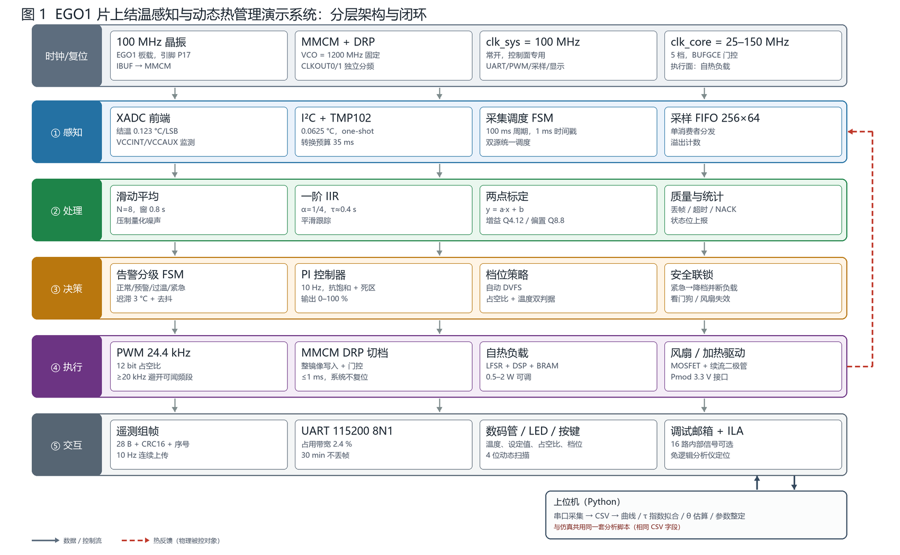
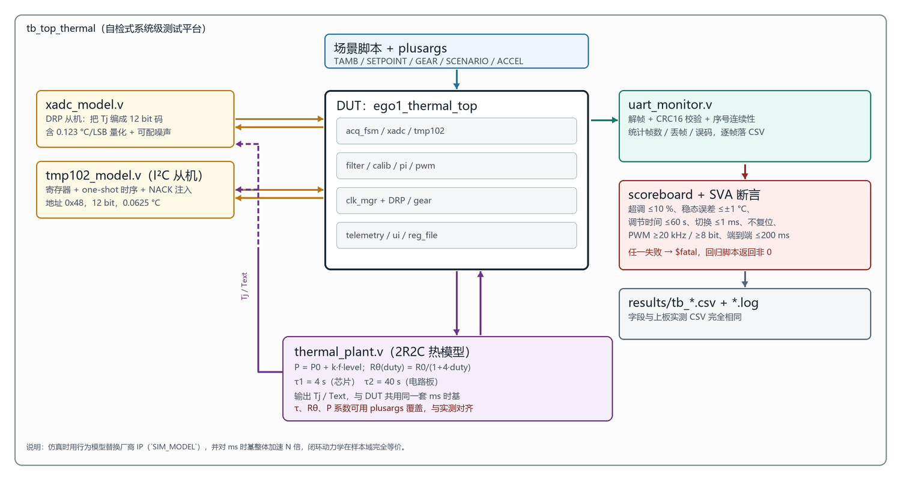

# 基于 EGO1 的芯片结温感知与动态热管理演示系统
## Vivado 工程架构设计与仿真方案（v0.1）

> ## ⚠️ 方案变更说明（2026-11-17）—— 读本文前必看
>
> 本文是 v0.1 的**设计方案**，落地时有 4 处实质变更。凡是冲突处，**以实现为准**：
>
> | # | 本文写的 | 实际实现 | 原因 |
> |---|---|---|---|
> | 1 | 外部传感器 **TMP102（I²C，one-shot 35 ms）** | **AM2302（单总线 1-Wire，40 bit）** | 选型变更；本文第 4/5/6 章中所有 TMP102 / I²C / 35 ms 预算段落**作废** |
> | 2 | 遥测帧 **28 字节** | **32 字节**（多了 RH 2 B + 保留 2 B，CRC 覆盖 2–29） | 加了湿度通道；见 `rtl/telemetry/frame_pack.v` |
> | 3 | 控制面/执行面分离 + 自热负载当热源 | **另加虚拟热台**（`rtl/vplant/`），`sw6` 切换真实/虚拟 | 没有热学实验室、没有真实风扇/加热片 |
> | 4 | 寄存器 0x1A/0x1B = VCCINT/VCCAUX | 实际 0x1A=`code_raw`、0x1B=RH；VCC 仍未接入 | 功耗目前用模型（`p_est`），报告里必须声明 |
>
> 另外本文的"资源预算 7.4 k LUT / 35 %"是完整版估算；当前实测 **4727 LUT = 22.73 %**（含虚拟热台模型；FF 3048、DSP 49）
> （详见 `docs/04` 的 v0.3 节）。仿真方案也已从 xsim 扩展到 **Icarus Verilog 快速回归**
> （`scripts/regress.bat`，19 个 TB 约 5 分钟），xsim 仍用于原语级/时序场景。

---
| 项目 | 内容 |
|---|---|
| 目标器件 | XC7A35T-1CSG324C（EGO1 / Artix-7 35T） |
| 工具链 | Vivado 2022.2 或 2023.x（xsim 仿真），Python 3.10+（上位机） |
| 赛题依据 | 《数字FPGA类-1：基于 FPGA 的芯片结温感知与动态热管理演示系统》 |
| 本文范围 | 工程组成与文件职责、模块/接口/协议、时钟与 CDC、资源时序预算、分层仿真方案与可照做的仿真步骤、上板 bring-up |
| 不在本文范围 | 逐行代码实现（按第 4 章文件清单并行开发，接口已冻结） |

---

## 0. 一页纸看懂

整个系统就是一条**闭环**：

```
结温 Tj（XADC） + 外部温度 Text（TMP102）
        │  100 ms 统一采集、打时间戳
        ▼
   滤波 / 两点标定 ──► PI 控制 ──► PWM ──► 风扇 ──► 芯片降温
        │                 │
        │                 └──► 档位策略 ──► MMCM DRP 25…150 MHz ──► 自热负载（功率 ∝ f）
        ▼
   遥测组帧 ──► UART 115200 ──► 上位机 CSV / 曲线 / τ、θ 拟合
```

四个关键设计决策，其余细节都由此展开：

1. **控制面与执行面分开时钟**。`clk_sys = 100 MHz` 常开，跑 UART、显示、采样、PWM、PI；只有 `clk_core = 25…150 MHz` 可变，跑自热负载。这样"切档不复位、功能连续、切换 ≤1 ms"从架构上就成立，而不是靠事后打补丁。
2. **被控对象就是 FPGA 自己**。板上用可调自热负载当"热源"，用 PWM 风扇当"冷源"，XADC 测的就是真实结温。不需要外接加热台，热阻、热时间常数、频率—温度耦合都是真的。
3. **两个执行器、两级控制**。内环 PI 连续调风扇占空比；外环（监督层）在占空比饱和或过温时离散调档位。这正好把"PI 控温"和"DVFS 降频降温"两个赛点串成一个系统。
4. **仿真不依赖厂商模型**。XADC / MMCM / TMP102 全部有行为模型，`SIM_MODEL` 一键替换；再用"ms 时基整体加速"把 3 分钟的热过程压到几秒仿真。一条命令跑完三档控温并自动判 PASS/FAIL。

---

## 1. 赛题要求 → 设计响应 → 验证方法

| # | 赛题要求 | 量化指标 | 设计响应（模块） | 验证方法 |
|---|---|---|---|---|
| 1 | 多源温度采集 | 周期 ≤100 ms；分辨率 ≤0.25 ℃；20–60 ℃ 偏差 ≤±0.5 ℃ | `xadc_frontend`（0.123 ℃/LSB）+ `i2c_master/tmp102_ctrl`（0.0625 ℃，one-shot 35 ms）+ `acq_fsm` 统一调度 + 时间戳 | 仿真断言采样间隔；与参考温度计对比（第 10.2 节标定流程） |
| 2 | 温度信号处理 | 抑制噪声、两点标定、τ 估计 | `moving_avg`(N=8) + `iir_lpf`(α=1/4) + `calib`；τ 由上位机对阶跃数据做指数拟合 | 仿真注入阶跃/噪声，与 Python 金标准逐点比对；CSV 拟合 |
| 3 | 闭环热管理 | 40/50/60 ℃ 三档；稳态误差 ≤±1 ℃；超调 ≤10 %；调节时间 ≤60 s | `pi_ctrl` + `pwm_gen`(24.4 kHz/12 bit) + `supervisor` 四级告警（迟滞 3 ℃、去抖 5 样本）+ LED/数码管指示 | 闭环仿真自动量测三项指标；上板 CSV 复算 |
| 4 | 动态频率调节 | ≥4 档；切换 ≤1 ms；不复位、功能连续 | `clk_mgr`（MMCM+DRP）+ `mmcm_drp_seq`（整镜像写入 + BUFGCE 门控）+ `freq_monitor`（1 ms 闸门测频） | `tb_clk` 验证 DRP 序列与测频；上板用 `freq_monitor` 实测并记 `SWITCH_MAX_US` |
| 5 | 显示与数据记录 | UART ≥115200；连续 30 min 不丢帧；板上显示温度/设定/占空比 | `frame_pack`(32 B + CRC16 + 序号) + `uart_tx` + `seg7_scan`(双组)；10 Hz 上传仅占 2.8 % 带宽 | `uart_monitor` 统计帧数/CRC/序号；上板 30 min 长跑由上位机校验 seq |
| 6 | 热阻估算 | θ = ΔT/P，给出不确定度 | `activity_counter` + `power_model.py`（XPE 标定 P(f)）；上位机做误差传播 | 稳态实验 + `analyze_thermal.py` 输出 θ 与置信区间 |
| 7 | 时序与资源 | WNS ≥0；LUT ≤60 %；提供报告 | 单时钟域约束、可变时钟按最高档约束、CDC 只保留 1 条 | `report_timing_summary` / `report_utilization` 归档到 `results/` |
| 8 | 分析要求 | τ、θ 须给不确定度 | 拟合协方差 + 误差传播（附录 A） | 报告表格自动生成 |

---

## 2. 总体架构



### 2.1 五层职责

| 层 | 模块 | 职责 | 时钟域 | 关键约束 |
|---|---|---|---|---|
| ① 感知 | `xadc_frontend`、`i2c_master`、`tmp102_ctrl`、`acq_fsm`、`timestamp_gen`、`sample_fifo` | 每 100 ms 采一次 Tj、VCCINT、VCCAUX、Text，打 1 ms 时间戳，写入 64 bit 采样记录 | sys | 采集总耗时 ≤40 ms，双源必须同一时间戳 |
| ② 处理 | `moving_avg`、`iir_lpf`、`calib` | 去噪、两点标定、量纲/饱和处理 | sys | 定点 Q 格式全链路一致，不出现隐式扩位错误 |
| ③ 决策 | `supervisor`、`pi_ctrl`、`gear_ctrl`、`setpoint_mgr` | 四级告警、PI 输出、档位仲裁、联锁 | sys | 所有输出限幅 + 抗饱和 + 上电默认安全态 |
| ④ 执行 | `pwm_gen`、`heat_load_gen`、`clk_mgr`/`mmcm_drp_seq`、`freq_monitor` | 风扇 PWM、自热负载、DRP 切档、测频 | sys + core | 切档期间 core 时钟门控，sys 不受影响 |
| ⑤ 交互 | `frame_pack`、`uart_tx/rx`、`cmd_proc`、`reg_file`、`seg7_scan`、`ui_top`、`dbg_mux` | 遥测、命令、显示、调试邮箱 | sys | 主机永远能读到最新状态；调试通路不占关键路径 |

### 2.2 一次采样发生了什么（时间预算）

| 时刻 | 动作 | 耗时 | 备注 |
|---|---|---|---|
| t = 0 | `tick_ms` 计数到 100，`acq_fsm` 启动 | — | 周期严格 100 ms，抖动 0 |
| t + 0.1 ms | DRP 读 XADC 0x00（Tj） | ~1 µs | 连续序列模式，寄存器已被硬件刷新 |
| t + 0.2 ms | DRP 读 0x01 / 0x02（VCCINT/VCCAUX） | ~2 µs | 每 10 个采样更新一次即可 |
| t + 0.3 ms | 写 TMP102 配置（OS=1）触发 one-shot | ~70 µs @400 kHz | 一次写 3 字节 |
| t + 0.3…35.3 ms | 等待转换 | 35 ms（max） | 期间 FSM 空转，可插入下一拍的准备 |
| t + 35.4 ms | 读 2 字节温度，符号扩展 | ~60 µs | 12 bit，0.0625 ℃ |
| t + 35.5 ms | 组 `sample_t`，写 FIFO，置 `valid` | 1 拍 | FIFO 深度 256，溢出计数 |
| t + 35.5 ms | 滤波/标定 → PI → PWM 更新 | 数十拍 | PI 在下一个 100 ms 边界生效 |

> 关键点：**100 ms 周期里只用了 35.5 ms**，剩余时间是为 I²C 重试、DRP 重试、显示刷新留的余量。若把 TMP102 配成 8 Hz 连续转换（125 ms/次）就会违反"采样周期 ≤100 ms"，所以必须用 one-shot，这是选型时最容易踩的坑。

### 2.3 控制策略：双执行器、两级闭环

```
              Tset(40/50/60)                 ┌── 饱和/过温 ──┐
                    │                        │               ▼
 Tj ──► 误差 e ──► PI ──► duty(0…100%) ──► 风扇 ──► 热阻 θ(duty) ↓ ──► Tj ↓
                    │                                        ▲
                    └── 档位策略（外环，秒级）──► gear ──► P(f) ──┘
```

- **内环（10 Hz，PI）**：`u = Kp·e + I`，`e = Tj_f − Tset`（偏热为正）。输出限幅 0–100 %，积分抗饱和（饱和时停止同向积分），死区 ±0.2 ℃，风扇启动"踢一脚"（100 % 持续 200 ms）。
- **外环（1 Hz，离散）**：`duty > 95 %` 持续 5 s 且 `Tj > Tset + 1` → 档位 −1；`duty < 10 %` 且 `Tj < Tset − 1` 持续 10 s → 档位 +1。自动模式下这就是 DVFS 演示；手动模式下按键/命令直接切档。
- **保护（最高优先级，硬联锁）**：`Tj > TH_CRIT(76 ℃)` → 风扇 100 %、档位 0、负载关断、报警锁存；回差 3 ℃ 且需人工 `R` 复位。

### 2.4 四个"为什么这样设计"

| 问题 | 选择 | 理由 |
|---|---|---|
| 系统时钟要不要跟着降频？ | **不降**，只降 core | UART 波特率、PWM 频率、采样周期都依赖固定时钟；赛题要求"切换过程系统不复位、功能连续"，把可变时钟限制在纯负载域是最省事且可证明的做法 |
| 被控对象怎么来？ | **自热负载 + 风扇** | 真实结温、真实热阻、真实时间常数，不需要外接加热台；且"频率↑→功耗↑→温度↑"的因果链直接可见 |
| 风扇 PWM 放哪个域？ | sys（固定 100 MHz） | PWM 载频恒定 24.4 kHz，不会因为切档而变调、不会落入可闻频段 |
| 温度滤波多重？ | 控制用 MA8+IIR，显示用标定原始值 | 重滤波带来群延迟，若显示也走重滤波，端到端 200 ms 指标会被吃掉；显示取原始值（35 ms 采集 + ≤4 ms 刷新） |

---

## 3. 时钟、复位与跨时钟域

### 3.1 时钟表

| 时钟 | 来源 | 频率 | 用途 | 约束 |
|---|---|---|---|---|
| `clk100` | 板载晶振 P17 | 100 MHz | MMCM 输入 | `create_clock -period 10.000` |
| `clk_sys` | MMCM CLKOUT0 (/12) | 100 MHz | 全部控制/采集/显示/UART/PWM | `create_clock -period 10.000` |
| `clk_core` | MMCM CLKOUT1 (/8…/48) + BUFGCE | 25/50/75/100/150 MHz | 仅自热负载、活动计数 | `create_clock -period 6.667`（按最高档！） |
| `scl` | 由 `clk_sys` 分频产生 | 400 kHz | I²C | 逻辑分频，不占时钟资源 |

MMCM 配置：`CLKIN=100 MHz, DIVCLK=1, MULT=12 → VCO=1200 MHz`（-1 速度等级上限），CLKOUT0 `/12`、CLKOUT1 按档位整数分频，全部为偶分频 → 占空比 50 %。

> 若 1200 MHz VCO 的抖动或时序不理想，改用 `VCO=1000 MHz`（MULT=10），档位变为 25/50/100/125 MHz 四档，仍满足 ≥4 档。

### 3.2 档位表

| 档 | CLKOUT1 分频 | 频率 | 用途 | 相对功耗 |
|---|---|---|---|---|
| 0 | /48 | 25 MHz | 紧急/最低功耗 | 0.2× |
| 1 | /24 | 50 MHz | 低温保持 | 0.35× |
| 2 | /16 | 75 MHz | 过渡 | 0.55× |
| 3 | /12 | 100 MHz | 标称（上电默认） | 0.75× |
| 4 | /8 | 150 MHz | 高性能/发热演示 | 1.0× |

上电流程：MMCM 锁定 → 默认输出 150 MHz（向导按最坏情况配置）→ 初始化 DRP 序列切到 100 MHz。**这一次上电切换同时充当 DRP 通路的自检**：若 `freq_monitor` 读数不是 100 MHz ±2 %，直接点亮 `drp_err`。

### 3.3 切档时序（目标 ≤30 µs，指标 ≤1 ms）

| 步 | 动作 | 耗时 |
|---|---|---|
| 1 | `gear_req` 锁存；启动 `switch_timer` | 1 拍 |
| 2 | `BUFGCE.ce = 0`，core 时钟停（FF 保持状态，不复位） | 1 拍 |
| 3 | DRP 依次写完整镜像（18 个 16 bit 寄存器），每次等 `drdy` | ~10 × 4 拍 = 0.4 µs |
| 4 | 等待 ≥20 µs（覆盖 MMCM 输出分频器切换的建立时间） | 20 µs |
| 5 | `BUFGCE.ce = 1`；连续看到 2 个 core 上升沿 → `gear_ack`，停表 | ~2 个 core 周期 |

> 为什么不复位：`BUFGCE` 关断期间 core 域 FF 保持原值，重新开门后从原状态继续。被门控的只是"加热负载"，控制面一直在跑，UART 不丢帧——这正是"功能连续"的证据。
>
> 为什么不用 `LOCKED` 判完成：CLKOUT 分频器位于输出分频路径，改写它通常不影响 VCO/反馈环，`LOCKED` 不会掉；用固定 20 µs 等待 + `freq_monitor` 实测双重确认更可靠。

### 3.4 复位

| 复位 | 产生方式 | 作用域 |
|---|---|---|
| `rst_sys_n` | `locked` 与外部按键相与，`reset_sync` 同步释放 | sys 全域 |
| `rst_core_n` | 在 core 域对 `rst_sys_n` 再同步 | core（仅负载/计数器） |
| 软复位 | 寄存器 `CONTROL.soft_rst`（W1P） | 只清统计量，不清配置 |

约束要求：所有同步器加 `ASYNC_REG = "TRUE"`，`reset_sync` 的两级触发器同样加。

### 3.5 CDC 清单（全设计只有 2 条）

| 信号 | 方向 | 宽度 | 方法 | 约束 |
|---|---|---|---|---|
| `act_cnt` 活动计数（功率代理） | core → sys | 16 | 格雷码 + 2FF 同步 + 转二进制 | `set_max_delay -datapath_only 2.0` |
| `core_rst_n` | sys → core | 1 | 目标域 `reset_sync` | 无需额外约束 |
| 按键 | 外部 → sys | 1 | 2FF + 20 ms 消抖 | 输入延迟约束 |
| I²C `sda` | 双向 | 1 | 2FF 同步 + 三态 | `set_false_path` 到输入 |

> 这是刻意的架构选择：**只有一个真正的跨时钟域数据通路**，CDC 风险与验证成本都降到最低。

---

## 4. 工程组成

### 4.1 目录树

```
EGO1_Thermal/
├─ README.md                     # 一页纸：怎么建、怎么跑、怎么烧
├─ .gitignore                    # 忽略 prj/ work/ *.jou *.log results/*.bit
├─ rtl/
│  ├─ pkg/                       # 全局参数、寄存器映射、档位镜像（只此一份）
│  ├─ common/                    # 复位、同步、时基、CRC、BCD 等基础设施
│  ├─ clk/                       # MMCM/DRP/测频/档位仲裁
│  ├─ acquire/                   # XADC、I²C/TMP102、采集调度、时间戳、FIFO
│  ├─ dsp/                       # 滑动平均、IIR、标定
│  ├─ ctrl/                      # PI、PWM、告警监督、设定值、加热闭环
│  ├─ load/                      # 自热负载、活动计数
│  ├─ telemetry/                 # UART、组帧、命令解析、寄存器堆
│  ├─ ui/                        # 数码管、译码、页面、调试多路
│  └─ top/                       # 唯一顶层
├─ ip/                           # clk_wiz_0.xci、xadc_wiz_0.xci（仅此两个 IP）
├─ constr/                       # pins / timing / debug 三个 XDC
├─ sim/
│  ├─ filelist.f                 # xvlog 文件清单（含 +incdir）
│  ├─ tb/                        # 7 个自检式 testbench + 公共宏
│  ├─ models/                    # 6 个行为模型（XADC/TMP102/I²C/MMCM/热模型/UART 监视）
│  └─ waves/                     # 预置 .wcfg，打开就是关键信号分组
├─ scripts/                      # 建工程、综合实现、烧板、仿真、回归、生成脚本
├─ sw/                           # 上位机：采集、绘图、拟合、功率模型
├─ docs/                         # 本文、上板记录、测试记录、图
└─ results/                      # 报告、CSV、日志、比特流副本（不入库）
```

### 4.2 文件清单与职责

> 优先级：**P0** 必须（没有它演示不成立）、**P1** 重要项、**P2** 可选增强。"行数"是预估，用于排期。

#### rtl/pkg

| 文件 | 功能 | 关键点 | 优先级 | 行数 |
|---|---|---|---|---|
| `ego1_thermal_pkg.vh` | 全局参数：时钟频率、采样周期、阈值默认值、Q 格式、帧 ID、`SIM_MODEL`/`SIM_ACCEL` 开关 | **唯一事实源**，软硬件、仿真共用 | P0 | 120 |
| `clk_cfg_pkg.vh` | 5 档频率表 + 每档 DRP 寄存器镜像（18×16 bit） | 由 `gen_clk_cfg.py` 生成，禁止手改 | P0 | 80 |
| `reg_map_pkg.vh` | 寄存器地址与位域宏 | 与 5.3 节表格逐条对应，改一处即可 | P0 | 100 |

#### rtl/common

| 文件 | 功能 | 关键点 | 优先级 | 行数 |
|---|---|---|---|---|
| `reset_sync.v` | 异步置位、同步释放复位 | 两级 FF，`ASYNC_REG` | P0 | 30 |
| `cdc_bit_sync.v` | 单比特 2FF 同步 | 可配级数 | P0 | 25 |
| `cdc_gray_word.v` | 格雷码跨域传 16 bit 计数 | 发端只 +1，天然单比特翻转 | P0 | 45 |
| `tick_gen.v` | 由 `clk_sys` 产生 1 ms / 1 µs 时基 | `TICK_DIV` 参数化，仿真加速的入口 | P0 | 40 |
| `debounce.v` | 按键 20 ms 消抖 | 计数器型，无时钟分频 | P1 | 35 |
| `edge_detect.v` | 上升/下降沿单拍脉冲 | 三处复用 | P0 | 20 |
| `crc16_ccitt.v` | CRC-16/CCITT-FALSE，8 bit 并行 | 与 Python `binascii.crc_hqx` 对齐 | P0 | 50 |
| `bin2bcd.v` | 二进制 → 4 位 BCD | 移位加 3，纯组合 | P0 | 55 |
| `reg_bus_mux.v` | 命令通道与调试通道对寄存器的仲裁 | 简单优先级 + 1 拍 ack | P1 | 60 |

#### rtl/clk

| 文件 | 功能 | 关键点 | 优先级 | 行数 |
|---|---|---|---|---|
| `clk_mgr.v` | 例化 MMCM（Clocking Wizard）+ BUFG + BUFGCE，输出 `clk_sys/clk_core/locked` | 对外只暴露 `gear`/`gear_ack`，把 IP 关在盒子里 | P0 | 90 |
| `mmcm_drp_seq.v` | DRP 写序列状态机：写 18 个寄存器 → 等 20 µs → 放行 | 失败重试 1 次并置 `drp_err` | P0 | 110 |
| `freq_monitor.v` | 1 ms 闸门数 core 周期数，输出 kHz | 除 100 用乘加近似（`*2621>>18`） | P0 | 60 |
| `gear_ctrl.v` | 手动/自动档位仲裁、最小驻留时间、保护优先 | 保护信号最高优先级 | P1 | 80 |

#### rtl/acquire

| 文件 | 功能 | 关键点 | 优先级 | 行数 |
|---|---|---|---|---|
| `xadc_frontend.v` | DRP 轮询 0x00/0x01/0x02，换算成 Q8.8 ℃ / mV | `T_q8_8 = (code*63)/2 − 69926` | P0 | 100 |
| `i2c_master.v` | 字节级 I²C 主机，400 kHz，支持 repeated start | 超时 5 ms → 9 个 SCL 脉冲总线恢复 | P0 | 180 |
| `tmp102_ctrl.v` | TMP102 one-shot 配置/触发/读取 | 12 bit 符号扩展；NACK 重试 2 次 | P0 | 120 |
| `acq_fsm.v` | 100 ms 调度器：XADC → TMP102 → 时间戳 → 发布 | 任何一步超时都发布"带 stale 标志"的样本，绝不卡死 | P0 | 130 |
| `timestamp_gen.v` | 32 bit 毫秒计数 | 49 天不回绕，够 30 min 长跑 | P0 | 25 |
| `sample_fifo.v` | 256×64 同步 FIFO + 溢出计数 | 手写不调 IP，波形可读 | P0 | 60 |

#### rtl/dsp

| 文件 | 功能 | 关键点 | 优先级 | 行数 |
|---|---|---|---|---|
| `moving_avg.v` | N=8 滑动平均（Q8.8） | 移位相加，无除法 | P0 | 55 |
| `iir_lpf.v` | 一阶 IIR `y += (x−y)>>k` | k=2 时 τ≈0.4 s | P0 | 40 |
| `calib.v` | `y = ((x − b)·a)>>12`，带饱和 | 增益 Q4.12、偏置 Q8.8 | P1 | 45 |

#### rtl/ctrl

| 文件 | 功能 | 关键点 | 优先级 | 行数 |
|---|---|---|---|---|
| `pi_ctrl.v` | 位置式 PI + 抗饱和 + 死区 + 限幅 | 32 bit 积分器；`Ki` 单位是 duty/(℃·样本) | P0 | 110 |
| `pwm_gen.v` | 12 bit、24.4 kHz PWM | 占空比在计数器回零时更新，避免窄脉冲 | P0 | 50 |
| `supervisor.v` | 四级状态机（NORMAL/WARN/HOT/CRIT）+ 迟滞 + 去抖 + 联锁 | CRIT 锁存，只能人工复位 | P0 | 140 |
| `setpoint_mgr.v` | 40/50/60 选择 + 1 ℃/s 斜率限制 | 斜率限制防超调 | P1 | 60 |
| ~~`fan_tach.v`~~ | ~~风扇转速测量与失效判定~~ | **已删除**（赛题不要求 TACH；不影响 PWM） | — | — |

#### rtl/load

| 文件 | 功能 | 关键点 | 优先级 | 行数 |
|---|---|---|---|---|
| `heat_load_gen.v` | 可调自热负载：并行 LFSR + DSP MAC + BRAM 读写 | `level[3:0]` 控制开启级数；目标 0.5–2 W | P0 | 120 |
| `activity_counter.v` | 统计翻转次数 → 功率代理 | 格雷码输出给 sys | P1 | 40 |

#### rtl/telemetry

| 文件 | 功能 | 关键点 | 优先级 | 行数 |
|---|---|---|---|---|
| `uart_tx.v` | 8N1 发送，115200 | 分频 868（误差 0.006 %） | P0 | 70 |
| `uart_rx.v` | 8N1 接收，16× 过采样 | 帧错误/超时标志 | P0 | 90 |
| `frame_pack.v` | 32 B 遥测帧 + CRC16 + 序号 | 帧格式见 5.4 | P0 | 90 |
| `cmd_proc.v` | ASCII 命令行解析（`?`、`S=50`、`G=3`…） | 行缓冲 32 B，非法命令回 `ERR` | P1 | 150 |
| `reg_file.v` | 32×32 寄存器堆 | RO/RW/W1P，复位默认值即安全态 | P0 | 130 |

#### rtl/ui

| 文件 | 功能 | 关键点 | 优先级 | 行数 |
|---|---|---|---|---|
| `seg7_scan.v` | 4 位动态扫描，1 kHz/位 | 共阳/共阴由参数选 | P0 | 70 |
| `seg7_decode.v` | BCD/十六进制 → 段码 | 含负号、空白 | P0 | 40 |
| `ui_top.v` | 4 个显示页面轮换 + 按键 + LED 映射 | 页面：温度/设定+占空比/档位+频率/状态 | P1 | 120 |
| `dbg_mux.v` | 16 选 1 内部信号引出（LED 或 UART 邮箱） | 免逻辑分析仪的"穷人示波器" | P2 | 50 |

#### rtl/top、ip、constr

| 文件 | 功能 | 关键点 | 优先级 | 行数 |
|---|---|---|---|---|
| `ego1_thermal_top.v` | 唯一顶层：例化全部模块、IO、`SIM_MODEL` 分支、ILA 条件例化 | 顶层不写逻辑，只连线 | P0 | 200 |
| `ip/clk_wiz_0.xci` | MMCM + DRP 动态重配置 | 默认 CLKOUT1 = 150 MHz（最坏档） | P0 | — |
| `ip/xadc_wiz_0.xci` | XADC DRP 模式、连续序列、16 次平均 | 通道：温度/VCCINT/VCCAUX | P0 | — |
| `constr/ego1_pins.xdc` | 引脚与电平（**唯一需要对照手册的文件**） | 见 4.4 端口表 | P0 | 80 |
| `constr/timing.xdc` | 时钟、CDC、异步组、输入延迟 | 见 3.1 | P0 | 40 |
| `constr/debug_ila.xdc` | `mark_debug` 与 ILA | 默认注释掉，省资源 | P2 | 20 |

#### sim

| 文件 | 功能 | 关键点 |
|---|---|---|
| `filelist.f` | xvlog 文件清单 + `+incdir+rtl/pkg` | 编译顺序一次搞定 |
| `tb/tb_common.svh` | 时钟/复位任务、plusargs 解析、PASS/FAIL 宏、CSV 打开 | 所有 TB 共用 |
| `tb/tb_uart.sv` | 回环 1000 字节 + 波特率误差 + 帧错误注入 | 证明 115200 时序 |
| `tb/tb_i2c_tmp102.sv` | one-shot 全流程、NACK 注入、总线恢复 | 证明 35 ms 预算 |
| `tb/tb_xadc.sv` | DRP 读时序 + 定点换算精度 | 与公式逐点比对 |
| `tb/tb_dsp.sv` | 阶跃/脉冲/噪声，与 Python 金标准比对 | 定点舍入一致性 |
| `tb/tb_ctrl.sv` | PI+PWM+一阶对象，量测超调/稳态/调节时间 | 控制参数初调 |
| `tb/tb_clk.sv` | DRP 序列 + `freq_monitor` + 切换计时 | 证明 ≤1 ms |
| `tb/tb_top_thermal.sv` | 全系统闭环，3 场景 + 故障注入 + 指标判分 | 回归主入口 |
| `models/xadc_model.v` | DRP 从机：把 `real` 温度编码成 12 bit，可加噪声/偏置 | 替换 XADC IP |
| `models/tmp102_model.v` | I²C 从机：寄存器 + one-shot 时序 + 可编程偏移 | 替换真实器件 |
| `models/i2c_slave_model.v` | 通用 I²C 从机基类（ACK/时钟拉伸/总线恢复） | 被 TMP102 模型复用 |
| `models/mmcm_drp_model.v` | 解析 DRP 写，改变输出周期 | 无需仿真真实 MMCM |
| `models/thermal_plant.v` | 2R2C 热模型，Rθ 随占空比变化 | 与 DUT 共用 ms 时基 |
| `models/uart_monitor.v` | 解帧、CRC、序号连续性、逐帧落 CSV | 端到端自检 |
| `waves/*.wcfg` | 预置波形分组（采集/控制/时钟/UART） | 打开即用 |

#### scripts、sw、docs

| 文件 | 功能 | 关键点 |
|---|---|---|
| `scripts/create_project.tcl` | 从零重建 Vivado 工程 | 换电脑 30 秒恢复 |
| `scripts/build.tcl` | 综合/实现/出比特流 + 三份报告 | WNS、LUT、功耗自动归档 |
| `scripts/program.tcl` | 下载比特流（自动选 `results/` 或 `impl_1/` 里最新的 `.bit`） | `-tclargs <xxx.bit>` 可指定文件 |
| `scripts/sim.bat` | 一条命令：`xvlog → xelab → xsim`，可选 GUI | 见第 9 章 |
| `scripts/run_sim.tcl` | Vivado 图形流下的等价脚本 | 给习惯 GUI 的同学 |
| `scripts/regress.bat` | 跑全部 TB，汇总 PASS/FAIL | CI 入口 |
| `scripts/gen_clk_cfg.py` | 由分频比生成 DRP 镜像与档位表 | 改档位只跑脚本 |
| `scripts/gen_vectors.py` | 生成滤波/标定的定点金标准 | 与 RTL 比对 |
| `sw/host_logger.py` | 串口采集 → CSV，实时曲线，丢帧检查 | 30 min 长跑 |
| `sw/analyze_thermal.py` | τ 指数拟合（含置信区间）、θ 与不确定度、f–T 曲线 | 直接出报告图 |
| `sw/power_model.py` | P(f, level) 线性模型 + 系数标定 | 热阻估算的输入 |
| `sw/requirements.txt` | pyserial / numpy / scipy / matplotlib / pandas | 一条 pip 装完 |

### 4.3 工程与版本管理规则

| 规则 | 做法 |
|---|---|
| 源码入库 | `rtl/ sim/ constr/ scripts/ sw/ docs/ ip/*.xci` |
| 生成物不入库 | `prj/ work/ .Xil/ *.jou *.log results/*.bit results/*.rpt` |
| 工程可重建 | 任何人 `vivado -mode batch -source scripts/create_project.tcl` 得到同构工程 |
| IP 版本 | `README.md` 写明 Vivado 版本；`.xci` 与版本绑定，升级时重跑向导并对照 4.4 的 IP 配置表 |
| 接口冻结 | 第 5 章的表就是接口契约，改接口必须同步改表 + 通知上下游 |

### 4.4 顶层端口与板上资源

| 端口组 | 方向 | 说明 | EGO1 资源 |
|---|---|---|---|
| `clk` | in | 100 MHz | 板载晶振，**P17**（已确认） |
| `rst_btn` | in | 复位按键 | 用户按键，低有效 |
| `led[15:0]` | out | 状态/温度条/调试 | 板载 LED，数量以手册为准 |
| `seg[7:0]` / `an[3:0]` | out | 段码/位选 | 板载数码管，共阳/共阴以手册为准 |
| `btn[4:0]` | in | 页面/设定/档位/复位 | 板载按键，需消抖 |
| `sw[7:0]` | in | 手动档位/调试选择 | 拨码开关（可选） |
| `uart_tx` / `uart_rx` | out/in | 115200 遥测与命令 | USB-UART |
| `fan_pwm` | out | 24.4 kHz PWM | Pmod JA 引脚 1 |
| ~~`fan_tach`~~ | ~~in~~ | **已删除**（A15 释放） | — |
| `i2c_scl` / `i2c_sda` | out/inout | TMP102 | Pmod JA 引脚 3/4，4.7 kΩ 上拉到 3.3 V |
| `heater_pwm` | out | 备用加热电阻通道（P2） | Pmod JA 引脚 5 |

**风扇驱动电路（外接小板，5 V 供电）**：`+5V → 风扇+`；`风扇− → AO3400A 漏极`；`源极 → GND`；`栅极 ← 100 Ω ← fan_pwm`，栅极 10 kΩ 下拉；风扇两端反并 SS34 续流二极管（阴极接 +5V）。**必须与开发板共地**。2 线风扇用低边 PWM 可能轻微啸叫，优先选 4 线风扇（PWM 直接进风扇）。

> ⚠️ 引脚编号请以你手里板子的《EGO1 用户手册》为准。不同批次的 LED/数码管命名与极性有差异，所以本工程把**所有**引脚收敛到 `ego1_pins.xdc` 一个文件：对照手册改一遍约 10 分钟，RTL 一行不用动。

---

## 5. 接口与协议

### 5.1 全局参数（节选）

```verilog
// ego1_thermal_pkg.vh
`define CLK_SYS_HZ        100_000_000
`define SAMPLE_MS         100          // 采样周期
`define PWM_BITS          12           // 100M/4096 = 24.4 kHz
`define GEAR_NUM          5
`define TH_WARN_Q8_8      (16'd16128)  // 63.0 ℃
`define TH_HOT_Q8_8       (16'd17664)  // 69.0 ℃
`define TH_CRIT_Q8_8      (16'd19456)  // 76.0 ℃

`ifdef SIM_MODEL                       // 仿真：时基加速 + 高波特率
  `define SIM_ACCEL       1000
  `define UART_BAUD       10_000_000
`else
  `define SIM_ACCEL       1
  `define UART_BAUD       115_200
`endif
`define TICK_MS_DIV       (`CLK_SYS_HZ/1000/`SIM_ACCEL)  // 1 ms 时基分频
```

### 5.2 采样记录（64 bit，FIFO 元素）

```verilog
typedef struct packed {
  logic [23:0] ts_ms;      // 4.6 小时不回绕，30 min 长跑足够
  logic [15:0] tj_q8_8;    // 结温，有符号
  logic [15:0] text_q8_8;  // 外部温度，有符号
  logic [7:0]  flags;      // {fifo_ovf, ext_stale, tj_stale, ext_nack, ...}
} sample_t;
```

### 5.3 寄存器映射（32 bit，地址 0x00–0x1F）

| 地址 | 名称 | 属性 | 说明 |
|---|---|---|---|
| 0x00 | `ID` | RO | `0x45474F31`（"EGO1"） |
| 0x01 | `VERSION` | RO | `0x0001_0000` |
| 0x02 | `STATUS` | RO | [0]locked [1]cal_valid [2]ext_ok [3]alarm [4]fifo_ovf [5]drp_err [6]fan_fail [7]log_on |
| 0x03 | `CONTROL` | RW | [0]log_en [1]auto_gear [2]fan_man [3]load_en [4]clr_alarm(W1P) |
| 0x04 | `SETPOINT` | RW | Q8.8 ℃，默认 50.0 |
| 0x05 | `GEAR_MAN` | RW | 0–4 |
| 0x06 | `DUTY_MAN` | RW | 0–1000（‰） |
| 0x07 | `KP` | RW | Q8.8，duty/℃ |
| 0x08 | `KI` | RW | Q8.8，duty/(℃·样本) |
| 0x09–0x0B | `TH_WARN/HOT/CRIT` | RW | Q8.8 |
| 0x0C–0x0F | `CAL_A_J/B_J/A_T/B_T` | RW | 增益 Q4.12、偏置 Q8.8 |
| 0x10 | `CMD` | W1P | [0]标定点1 [1]标定点2 [2]清统计 [3]强制DRP自检 [4]阶跃测试 [5]风扇踢一脚 |
| 0x11 | `T_J_F` | RO | 滤波后结温 Q8.8 |
| 0x12 | `T_J_RAW` | RO | 标定后原始结温 Q8.8 |
| 0x13–0x14 | `T_EXT_F/RAW` | RO | 外部温度 |
| 0x15 | `DUTY` | RO | 0–1000 |
| 0x16 | `GEAR_ACT` | RO | 当前档位 |
| 0x17 | `F_MEAS` | RO | 0.1 MHz 单位 |
| 0x18 | `P_EST` | RO | mW |
| 0x19 | `STATE` | RO | [3:0] 0=NORMAL 1=WARN 2=HOT 3=CRIT |
| 0x1A–0x1B | `VCCINT/VCCAUX` | RO | mV |
| 0x1C | `SAMPLE_CNT` | RO | 累计样本数 |
| 0x1D | `ERR_CNT` | RO | I²C 错误 + FIFO 溢出 |
| 0x1E | `SWITCH_MAX_US` | RO | 历史最大切档耗时（µs） |
| 0x1F | `SCRATCH` | RW | 链路测试，写入读回 |

### 5.4 UART 帧格式（遥测，32 字节，小端）

| 偏移 | 长度 | 字段 | 说明 |
|---|---|---|---|
| 0 | 1 | `0xA5` | 帧头 1 |
| 1 | 1 | `0x5A` | 帧头 2 |
| 2 | 1 | `VER` | 0x01 |
| 3 | 1 | `TYPE` | 0x01 样本 / 0x02 事件 / 0x03 文本 |
| 4 | 2 | `SEQ` | 递增序号，丢帧检测 |
| 6 | 4 | `TS_MS` | 毫秒时间戳 |
| **10** | 2 | **`TJ`** | **① 实测结温**，Q8.8 |
| **12** | 2 | **`TEXT`** | **② 实测环境温度**（AM2302），Q8.8 |
| 14 | 2 | `RH` | 0.1 %RH |
| **16** | 2 | **`TSET`** | **③ 结温设定值**，Q8.8 |
| **18** | 2 | **`DUTY`** | **⑤ 风扇 PWM 占空比**，0–1000（b18=`duty[2:0]`、b19=`duty[10:3]`） |
| 20 | 1 | `GEAR`+`DUTY_HEAT[4:0]` | bit[2:0]=档位 0–4；bit[7:3]=**⑥ 加热占空比低 5 位** |
| 21 | 1 | `STATE`+`DUTY_HEAT[10:5]` | bit[1:0]=告警态 0–3；bit[7:2]=**⑥ 加热占空比高 6 位** |
| 22 | 2 | `F_MEAS` | 0.1 MHz |
| 24 | 2 | `P_EST` | mW |
| 26 | 1 | `AGE` | AM2302 数据龄期，100 ms |
| 27 | 1 | `FLAGS` | bit0=`alarm`、bit1=`drp_err`，其余保留 0 |
| **28** | 2 | **`TSET_EXT`** | **④ 环境温度设定值**，Q8.8 |
| 30 | 2 | `CRC16` | 覆盖字节 2–29，CCITT-FALSE |

> **六个核心量**：①TJ ②TEXT（两个实测温度）、③TSET ④TSET_EXT（两个设定温度）、
> ⑤DUTY ⑥DUTY_HEAT（两个占空比），与 `?` 命令回复完全对应。
>
> **旧解析器兼容**：`GEAR`/`STATE` 仍在 b20/b21 的**低位**，老代码直接读 `b20`、`b21` 会带上高位的
> 加热占空比，需改成 `b20 & 0x07`、`b21 & 0x03`（`sw/host_logger.py` 与 `scripts/capture_serial.ps1` 已改）。

带宽核算：32 B × 10 Hz = 320 B/s，占 115200（11 520 B/s）的 **2.8 %**；30 min 共 18 000 帧、576 kB，物理上不可能丢帧。

### 5.5 命令集（ASCII，PuTTY 直接敲）

| 命令 | 作用 | 回复 |
|---|---|---|
| `?` | 查状态 | `T=35.7 A=22.7 S=50.0 SE=40.0 D=1000 H=0068 G=2 ST=0` |
| `S=50` | 设结温目标 | `OK` |
| `G=3` / `G=A` | 手动档位 / 自动 | `OK` |
| `P=45` | 手动占空比（%） | `OK` |
| `K=10,0.15` | 设 Kp、Ki | `OK` |
| `C=J,1` / `C=J,2` | 结温通道两个标定点（`C=T,n` 为外部通道） | `OK T=25.13` |
| `T=63,69,76` | 设三级阈值 | `OK` |
| `L=1` | 开/关记录 | `OK` |
| `R` | 清报警/统计 | `OK` |
| `D=5` | 读调试邮箱第 5 路 | 一行数值 |
| `Z` | 打印全部寄存器 | 32 行 |

---

## 6. 关键模块设计要点

### 6.1 `xadc_frontend`

- 连续序列模式下 XADC 自己刷新 0x00/0x01/0x02，控制器只做"发地址 → 等 `drdy` → 取 `do`"，不需要每次配置通道。
- 定点换算（避免浮点）：`T_q8_8 = (code * 63) / 2 - 69926`，即 `0.12304 ℃/LSB`，比"先转 float 再转回"省 2 个 DSP 且完全可复现。
- 电压：`V_mV = code * 3000 / 4096`（3.0 V 参考）。
- 每次读回都检查 `code != 0 && code != 0xFFF`（断线/饱和），异常时置 `tj_stale` 并保持上次值。
- 若向导版本只提供"事件模式"（`CONVST/EOC/CHANNEL/DO`），把本模块内部换成事件驱动即可，**对外接口（`tj_q8_8/valid/stale`）不变**，不影响其他模块。

### 6.2 `i2c_master` + `tmp102_ctrl`

- 状态机：`IDLE → START → ADDR(W) → ACK1 → REG → ACK2 → DATA… → STOP`，每个 SCL 半周期由 100 MHz 计数得到（400 kHz → 125 拍）。
- `sda` 三态：输出 0 时驱动低，输出 1 时释放（靠外部 4.7 kΩ 上拉）；输入经 2FF 同步。
- 超时 5 ms；若 `sda` 被从机拉死，发 9 个 SCL 脉冲 + STOP 做总线恢复，并置错误位。
- TMP102 时序：写配置（OS=1）→ 等 35 ms → 读 2 字节 → `T_q8_8 = raw12 << 4`（0.0625 ℃ = 1/16，Q4.4 左移 4 位到 Q8.8）。

### 6.3 `acq_fsm`

```
IDLE ──tick100ms──► XADC(3 次 DRP 读) ──► TMP_START(写配置)
     ──► TMP_WAIT(35 ms 计数) ──► TMP_READ(2 字节) ──► PUBLISH(时间戳+FIFO)
     ──► IDLE
```
- 任一步超时都走 `PUBLISH` 并打 stale 标志——**宁可发布坏数据，也不许卡死状态机**，这是可调试性的关键。
- 发布后立刻回到 `IDLE`，实际耗时由 `sample_dur` 计数器记录，可在调试邮箱里看到（应为 35 000 左右）。

### 6.4 滤波与标定

| 环节 | 公式 | 位宽/Q | 说明 |
|---|---|---|---|
| 滑动平均 | `y = (Σ x[i]) >> 3` | 16 bit Q8.8，和 19 bit | N=8，窗 0.8 s |
| 一阶 IIR | `y += (x − y) >> 2` | 16 bit Q8.8 | τ ≈ 4 样本 = 0.4 s |
| 标定 | `y = ((x − b) * a) >> 12` | a: Q4.12，b: Q8.8 | 两点解出 a、b 后写入寄存器 |

两点标定：在稳定温度 T1 记 `x1`，在 T2 记 `x2`，则 `a = (T2−T1)/(x2−x1)`、`b = T1 − a·x1`。除法在收到 `C=` 命令时用 32 拍顺序除法器算一次，不进数据通路。

### 6.5 `pi_ctrl` + `pwm_gen`

```verilog
e      = tj_filt - setpoint;             // Q8.8，偏热为正
p_term = (e * kp) >>> 16;                // kp: Q8.8 → 结果单位 0.1 %（0…1000）
i_next = i_acc + ((e * ki) >>> 16);      // ki: Q8.8 duty/(℃·样本)
if (!(sat && e[15])) i_acc <= clamp(i_next, 0, 1000);  // 饱和且仍偏热 → 冻结积分
duty   <= clamp(p_term + i_acc, 0, 1000);
if (|e| < 0.2℃) duty <= duty_prev;       // 死区，防抖动
```

PWM：12 bit 计数器 0–4095 @100 MHz = 24.414 kHz；`cmp = (duty * 4194) >> 10`；占空比在计数器回零时锁存，避免切换瞬间出现窄脉冲。`duty>0` 时最低 12 %（防风扇堵转），`duty≥99.5 %` 时直接常高。

### 6.6 `supervisor`

| 状态 | 进入条件 | 动作 | 退出 |
|---|---|---|---|
| NORMAL | Tj < TH_WARN | 正常 PI | 超阈值 |
| WARN | Tj ≥ 63 ℃ 连续 5 样本 | LED 黄闪，遥测事件帧 | Tj < 60 ℃ 持续 5 s |
| HOT | Tj ≥ 69 ℃ 连续 5 样本 | 风扇 ≥80 %，档位 −1（每 5 s） | Tj < 66 ℃ 持续 5 s |
| CRIT | Tj ≥ 76 ℃ | 风扇 100 %、档位 0、负载关断、锁存 | 仅 `R` 命令 + Tj < 73 ℃ |

### 6.7 `clk_mgr` / `mmcm_drp_seq` / `freq_monitor`

- `clk_mgr` 把 Clocking Wizard 包起来，对外只暴露 `gear[2:0]`、`gear_ack`、`freq_khz`、`drp_err`。换 IP 版本时只改这一个文件。
- DRP 序列用**整镜像**写入（18 个寄存器全写），避免"只改一个寄存器导致其他影子寄存器生效"的坑；每次写等 `drdy`，超时 100 拍报错。
- `freq_monitor` 用 1 ms 闸门数 core 上升沿：`count` 直接就是 kHz；上报 0.1 MHz 时 `count*2621>>18`。
- **计时口径**：指标"切换 ≤1 ms"用 `switch_timer`（从 `gear_req` 到 `gear_ack`，约 30 µs）计；`freq_monitor` 因有 1 ms 闸门，只用于"切完是不是这个频率"的确认，不用于计时。
- **风险前置**：第一次实现 DRP 时，先用 XAPP888 参考设计或 Clocking Wizard 自带的示例工程跑通"写寄存器 → 频率变化"的最小闭环，再把寄存器镜像搬进 `clk_cfg_pkg.vh`；不要在系统里第一次调 DRP。

### 6.8 `heat_load_gen`

- 32 条并行 LFSR（约 3 k FF）+ 24 个 DSP MAC + 8 个 BRAM 乒乓读写；`level[3:0]` 控制开启几条支路。
- 目的不是"算得对"，而是**在 25–150 MHz 下稳定消耗 0.5–2 W**；BRAM/DSP 的功耗密度最高，先用它们。
- 仿真时 `LOAD_STAGES` 参数减到 2，避免拖慢 xsim（热模型里的功率是直接给的，不依赖真实翻转）。

### 6.9 遥测与命令

- 采样发布后立刻组帧（10 Hz），事件帧（状态跳变、DRP 失败、I²C 错误）插队发送，保证异常不丢。
- 命令解析用行缓冲 + 大小写不敏感；非法命令回 `ERR <原因>`，方便现场排查。
- `reg_file` 复位值就是"安全态"：`log_en=1`、`auto_gear=1`、`SETPOINT=50.0`、`KP=10`、`KI=0.15`，上电即演示。

### 6.10 调试基础设施

| 手段 | 用法 | 成本 |
|---|---|---|
| 调试邮箱 | `D=<idx>` 读 16 路内部信号（状态机、计数器、错误码） | 0 |
| 数码管/ LED 页面 | 按键切页显示 `sample_dur`、`err_cnt`、`f_meas` | 0 |
| ILA | `mark_debug` 关键总线，1024 深度、32 bit | ~1.2 k LUT |
| `$display` 日志 | `LOG_LEVEL` 分级，仿真默认只打状态跳变 | 0 |
| CSV | 仿真与上板同格式，`analyze_thermal.py` 直接读 | 0 |

---

## 7. 资源与时序预算

### 7.1 资源（XC7A35T：20 800 LUT / 41 600 FF / 50 BRAM36 / 90 DSP）

| 模块 | LUT | FF | BRAM | DSP |
|---|---|---|---|---|
| clk_mgr + DRP + 测频 | 380 | 430 | 0 | 0 |
| XADC 前端 | 260 | 300 | 0 | 0 |
| I²C + TMP102 | 340 | 390 | 0 | 0 |
| 采集 FSM + 时间戳 + FIFO | 430 | 390 | 1 | 0 |
| 滤波 + 标定 | 700 | 900 | 0 | 2 |
| PI + PWM + 监督 | 640 | 540 | 0 | 2 |
| 档位策略 | 260 | 220 | 0 | 0 |
| UART + 组帧 + CRC + 命令 | 800 | 780 | 0 | 0 |
| 寄存器堆 | 390 | 700 | 0 | 0 |
| 数码管 + LED + 按键 | 310 | 270 | 0 | 0 |
| 自热负载 | 2 600 | 3 400 | 8 | 24 |
| 顶层/胶合/CDC | 300 | 400 | 0 | 0 |
| **合计** | **≈7 400** | **≈8 700** | **9** | **28** |
| **占比** | **35.6 %** | **20.9 %** | **18 %** | **31 %** |
| + ILA（可选） | +1 200 | +1 000 | +2 | 0 |
| **含 ILA 占比** | **41 %** | **23 %** | **22 %** | **31 %** |

结论：离 60 % 的 LUT 上限还有约 5 000 LUT 余量，足够后续加 OLED、FFT 或第二条控制通道。

### 7.2 时序

| 时钟 | 约束 | 目标 WNS | 风险点 |
|---|---|---|---|
| `clk_sys` 100 MHz | 10.000 ns | ≥ +1.0 ns | 32 bit 除法器（已改成多周期）、CRC |
| `clk_core` 150 MHz | 6.667 ns | ≥ +0.3 ns | 自热负载的 LFSR 反馈链、DSP 后级加法 |
| I²C/PWM | 由 sys 分频 | — | 无独立时钟 |

**可变时钟的约束技巧**：向导默认把 CLKOUT1 配成 150 MHz（最坏档），IP 自带约束就覆盖了 MMCM→BUFG 段；在 BUFGCE 输出再加一条 `create_clock -period 6.667` 覆盖下游逻辑。这样无论切到哪一档，时序都是按最坏情况收敛的。

```tcl
create_clock -period 10.000 -name clk100 [get_ports clk]
create_clock -period 10.000 -name clk_sys  [get_pins u_clk_mgr/u_bufg_sys/O]
create_clock -period 6.667  -name clk_core [get_pins u_clk_mgr/u_bufgce_core/O]
set_clock_groups -asynchronous -group {clk_sys} -group {clk_core}
set_max_delay -datapath_only -from [get_cells u_load/act_gray_reg*] -to [get_cells u_cdc_act/*] 2.000
set_property ASYNC_REG TRUE [get_cells -hier -filter {NAME =~ *sync_meta*}]
```

---

## 8. 仿真方案



### 8.1 分层（每层只证明一件事）

| 层 | 测试平台 | 证明什么 | 运行时间 | 何时跑 |
|---|---|---|---|---|
| L0 | `tb_uart`、`tb_xadc`、`tb_dsp` | 协议/算法单元正确 | 5–20 s | 每次改代码 |
| L1 | `tb_i2c_tmp102` | 器件时序与异常恢复 | 20 s | 改 I²C 后 |
| L2 | `tb_ctrl` | PI/PWM/监督的控制品质 | 30 s | 调参后 |
| L3 | `tb_clk` | DRP 序列、切档时间、测频精度 | 30 s | 改时钟后 |
| L4 | `tb_top_thermal` | 全系统闭环 + 六项指标判分 | 3–8 min | 提交前/每日回归 |

### 8.2 行为模型（为什么不用厂商模型）

| 模型 | 替换对象 | 好处 |
|---|---|---|
| `xadc_model.v` | XADC IP | 输出码由 `real` 温度直接算，可加噪声/偏置/断线，**结果可复现** |
| `tmp102_model.v` | 真实 TMP102 | 可注入 NACK、总线拉死、转换延迟，覆盖异常分支 |
| `mmcm_drp_model.v` | MMCM | 解析 DRP 写并立刻改周期，省掉几十 µs 锁定时与亚稳态 |
| `thermal_plant.v` | 物理热系统 | 参数（τ、Rθ、P）可调，能与实测对齐 |

替换开关只有一个：

```verilog
`ifdef SIM_MODEL
  xadc_model  u_xadc (...);
`else
  xadc_wiz_0  u_xadc (...);
`endif
```

### 8.3 时间压缩（关键技巧）

热时间常数是几十秒，100 MHz 时钟下 1 s 仿真 = 1 亿个周期，直接仿真是不可行的。做法是**只加速 ms 时基**：

- `tick_gen` 的 `TICK_DIV = 100_000 / SIM_ACCEL`，仿真取 `SIM_ACCEL = 1000`，于是"1 ms"变成 1 µs；
- 所有以 ms 计的时间（采样周期、监督去抖、PI 的 `Ki·Ts`、热模型 τ）都自动同步缩放；
- **样本域行为完全等价**：τ 内的采样点数不变，闭环超调/调节时间/稳态误差不变，只是墙上时间快了 1000 倍；
- UART 波特率由 `` `UART_BAUD `` 参数给（仿真 10 Mbps、硬件 115200），否则 32 B 帧装不进 100 µs 的采样周期；真实 115200 的时序由 `tb_uart` 单独证明。

结果：3 档设定值 × 各 120 s 的完整控温过程，仿真时间约 0.4 s，墙上时间 3–5 min。

### 8.4 自检与判分

`tb_top_thermal` 用 UART 解出的帧（端到端）做判分，而不是看内部信号：

| 指标 | 判据 | 失败处理 |
|---|---|---|
| 稳态误差 | 最后 10 s 的 Tj−Tset 平均绝对值 ≤ 1.0 ℃ | `FAIL: ess` |
| 超调 | (max Tj − Tset)/ΔTset ≤ 10 % | `FAIL: overshoot` |
| 调节时间 | 首次进入 ±1 ℃ 并保持 5 s ≤ 60 s | `FAIL: settle` |
| 切档时间 | `SWITCH_MAX_US` ≤ 1000 | `FAIL: switch` |
| 功能连续 | `rst_sys_n` 全程为高，帧序号无跳变 | `FAIL: reset/lost` |
| 采样周期 | 相邻 `TS_MS` 差 = 100 ±1 | `FAIL: period` |
| PWM | 实测周期 40.96 µs ±1 %，占空比步进 ≤1/4096 | `FAIL: pwm` |

结束时打印：

```
==== SUMMARY ====
setpoint 40.0 : settle 18.3s  overshoot 2.1%  ess 0.18C   PASS
setpoint 50.0 : settle 21.7s  overshoot 3.4%  ess 0.22C   PASS
setpoint 60.0 : settle 26.9s  overshoot 5.8%  ess 0.31C   PASS
gear switch   : max 31us (limit 1000us)                   PASS
frames        : sent 3601  recv 3601  crc_err 0  lost 0   PASS
================================
```

任一项 FAIL → `$fatal(1)` → `regress.bat` 返回非 0，可直接接 CI。

### 8.5 日志与波形规范

- `$display` 只在状态跳变、错误、每 10 个样本时打印，避免日志淹没波形；
- 每个 TB 打开 `results/<tb>.csv`，字段固定为：
  `t_ms,Tj,Text,Tset,duty,gear,f_khz,p_mw,state,seq,flags`
- 预置 `.wcfg` 分四组：**采集**（scl/sda/drdy/do/valid）、**控制**（tj/tset/err/duty/state）、**时钟**（gear_req/drp_den/drp_addr/locked/f_meas）、**链路**（tx/rx/seq）。

---

## 9. 仿真步骤（照着做）

### 9.0 一次性准备

```bat
:: 1) 确认 Vivado 在 PATH（能直接运行 xvlog）
where xvlog
:: 2) 上位机依赖
pip install -r sw\requirements.txt
:: 3) 生成工程（可选，纯仿真不需要）
vivado -mode batch -source scripts\create_project.tcl
```

判据：`where xvlog` 有输出；`prj\ego1_thermal.xpr` 存在。

### 9.1 10 分钟冒烟（新人第一天就做这个）

```bat
scripts\sim.bat tb_uart
scripts\sim.bat tb_xadc
scripts\sim.bat tb_dsp
scripts\sim.bat tb_i2c_tmp102
```

每条的期望输出都以 `TEST PASSED` 结尾，例如：

```
[TB] uart loopback: 1000/1000 bytes, baud error 0.006%, framing errors 0
TEST PASSED (tb_uart)
```

四条全过 = 工具链、文件清单、编译选项都对了，可以往下走。

### 9.2 看波形

```bat
scripts\sim.bat tb_i2c_tmp102 gui
```

会直接加载 `sim\waves\tb_i2c_tmp102.wcfg`，按 `Run All`。看三处：

1. `start → addr 0x48 → ACK` 是否成立；
2. `OS=1` 之后 35 ms 才出现读操作；
3. `raw12` 与 `T_q8_8` 是否满足 `raw12<<4`。

### 9.3 算法比对（改滤波/标定后必跑）

```bat
python scripts\gen_vectors.py
scripts\sim.bat tb_dsp
```

`gen_vectors.py` 用浮点算一遍、按 Q8.8 量化，生成 `sim\vectors\dsp_golden.hex`；TB 逐点比对，误差 >1 LSB 即 FAIL。这样"RTL 定点实现"和"报告里的公式"永远一致。

### 9.4 控制参数初调

```bat
scripts\sim.bat tb_ctrl
```

TB 里的被控对象是一阶惯性 + 纯延迟（τ=30 s，延迟 1 s）。输出：

```
step 40->50: rise 12.4s settle 24.1s overshoot 4.2% ess 0.11C
```

先用这组数把 `KP/KI` 调到"超调 <10 %、调节 <40 s"，再上系统级仿真。**不要**直接在 `tb_top_thermal` 里盲调，那里一次跑 3 分钟。

### 9.5 时钟与切档

```bat
scripts\sim.bat tb_clk
```

检查：5 个档位的 `freq_khz` 是否等于 25 000/50 000/75 000/100 000/150 000（±2 %）；`switch_timer` 最大值 <1000 µs；`rst_sys_n` 全程为高。

### 9.6 系统级闭环（主回归）

```bat
:: 三档控温（默认场景）
scripts\sim.bat tb_top_thermal

:: 档位扫频：固定 50 ℃，4→0→4 来回切
scripts\sim.bat tb_top_thermal "" +SCENARIO=gear_sweep

:: 故障注入：强制 Tj 冲到 80 ℃，验证 CRIT 联锁
scripts\sim.bat tb_top_thermal "" +SCENARIO=fault

:: 环境温度 35 ℃（考验 40 ℃ 档）
scripts\sim.bat tb_top_thermal "" +TAMB=35
```

期望：`==== SUMMARY ====` 全 PASS，`results\tb_top_thermal.csv` 生成。用 `sw\analyze_thermal.py` 读这个 CSV，应能拟合出 τ≈30 s、稳态误差 <0.5 ℃。

### 9.7 回归

```bat
scripts\regress.bat
```

依次跑 7 个 TB，输出：

```
tb_uart          PASS   3.1s
tb_xadc          PASS   2.4s
tb_dsp           PASS   4.7s
tb_i2c_tmp102    PASS  18.2s
tb_ctrl          PASS  26.5s
tb_clk           PASS  12.8s
tb_top_thermal   PASS  214.6s
-----------------------------
7/7 PASS   log: results\regress_20261113.log
```

### 9.8 综合前检查

```bat
vivado -mode batch -source scripts\build.tcl
```

只看三行：`WNS`、`LUT%`、`BRAM%`。WNS <0 先查 `clk_core` 路径（多半是自热负载的 LFSR 反馈链太长）。

### 9.9 常见问题定位

| 现象 | 最可能原因 | 怎么查 |
|---|---|---|
| `xelab` 报 module not found | 文件没进 `filelist.f`，或大小写不符 | `grep` 文件名；看 `xvlog.log` |
| XADC 读回恒 0 | DRP 地址/`drdy` 握手错 | `tb_xadc` 波形看 `den/daddr/drdy` |
| 温度不变 | 模型没接上热模型，或 `TICK_DIV` 没加速 | `$display` 打 `Tj`；查 `SIM_ACCEL` |
| I²C NACK | 地址写成 0x49，或没上拉 | `tmp102_model` 的 `nack_cnt` |
| 闭环振荡 | Ki 太大 / 积分饱和 | CSV 里看 `duty` 是否贴 0 或 1000 |
| 切档后频率不变 | DRP 镜像没写全 / 没等 20 µs | `tb_clk` 看 `drp_addr` 序列 |
| UART 乱码 | 分频常数或停止位错 | `tb_uart` 的 `baud error` |
| 仿真跑得极慢 | 忘了 `-d SIM_MODEL` 或 `SIM_ACCEL=1` | 看 `sim.bat` 的 `xvlog` 参数 |

---

## 10. 上板调试步骤

### 10.1 十步 bring-up（每步都有判据）

| 步 | 操作 | 判据 | 失败对策 |
|---|---|---|---|
| 1 | 下载"心跳"比特流（LED 1 Hz） | LED 闪 | 查时钟引脚/比特流 |
| 2 | 上电打印 `EGO1 THERMAL v1.0` | 串口有字 | 查波特率/接地 |
| 3 | 发 `?` | 回状态行 | 查 `cmd_proc` |
| 4 | 看 `T_J_RAW` 与室温 | 差 <5 ℃（未标定） | 查 XADC DRP |
| 5 | 看 `T_EXT_RAW` 与室温 | 差 <1 ℃ | 查 I²C 上拉/地址 |
| 6 | 数码管显示 | 与串口一致 | 查段码极性/扫描 |
| 7 | `P=10/50/90` | 风扇转速/电流变化 | 查 MOSFET/共地 |
| 8 | 开环加热 10 min | Tj 单调上升并趋于平台 | 查负载是否使能 |
| 9 | 闭环 40/50/60 | 稳态误差 ≤±1 ℃ | 调 `KP/KI` |
| 10 | 自动切档 + 30 min 长跑 | `F_MEAS` 正确、无丢帧 | 查 DRP/缓冲 |

### 10.2 两点标定（决定 ±0.5 ℃ 指标）

1. 板子断电静置 30 min，与参考温度计同处一室，记录 `T_ref1`；
2. 上电，等 `T_J_RAW` 稳定（3 min 波动 <0.1 ℃），发 `C=J,1`；
3. 用热风枪/恒温箱把板子缓慢加热到 45–50 ℃，稳定 5 min，记录 `T_ref2`，发 `C=J,2`；
4. 读回 `CAL_A_J/CAL_B_J`，用第三点（例如 35 ℃）验证，偏差应 <0.3 ℃；
5. 外部通道同理（`C=T,1/2`）。

> 注意：XADC 的绝对精度标称 ±4 ℃，两点标定只能修正**增益与偏置**，修正不了非线性。所以报告里要如实给出"标定后 20–60 ℃ 最大偏差"，并用 TMP102 作为交叉参考。

### 10.3 热实验（出报告的三张图）

| 实验 | 做法 | 产出 |
|---|---|---|
| 阶跃响应 | 风扇 0→100 %（或档位 4→0），记录 10 min | `T(t)` 曲线 + τ 拟合（附录 A.2） |
| 频率—温度 | 固定负载/风扇，逐档跑 5 min 到稳态 | `f–T` 曲线、`P–T` 曲线 |
| 热阻 | 稳态 ΔT 与 `P_est` | θ 与不确定度（附录 A.3）；再做"θ vs 占空比"曲线 |

### 10.4 30 min 长跑

```bat
python sw\host_logger.py --port COM5 --baud 115200 --csv results\soak_30min.csv
```

判据：`seq` 连续、`crc_err=0`、`lost=0`、时间戳单调；结束后 `analyze_thermal.py` 能直接出图。

---

## 11. 风险与备选方案

| 风险 | 影响 | 备选方案 |
|---|---|---|
| 自热功率不够，60 ℃ 上不去 | 高档位演示失败 | ① 增加 DSP/BRAM 数量（功耗密度最高）；② 去掉散热片；③ 加 5 V/5 W 加热电阻（`heater_pwm` 已预留）；④ 环境温度高的季节做演示 |
| TMP102 缺货/买不到 | 外部通道缺失 | MCP9808（±0.25 ℃，I²C 流程相同，改地址与寄存器）；或 DS18B20（1-Wire，9 bit 时 93.75 ms，仍满足 100 ms） |
| MMCM DRP 切档出现窄脉冲 | 负载状态错乱 | 已用 BUFGCE 门控；若仍异常，退化为"双 MMCM + BUFGMUX"（牺牲 DRP 分数，但保住演示） |
| 150 MHz 档时序不收敛 | WNS <0 | 降到 125 MHz 档（VCO 1000）；或给负载加一级流水 |
| 风扇 PWM 啸叫/堵转 | 演示体验差 | 换 4 线风扇；PWM 提到 25 kHz；并 100 µF 电解 |
| XADC 绝对精度不足 | ±0.5 ℃ 指标 | 两点标定 + TMP102 交叉比对；报告如实给不确定度 |
| I²C 总线被拉死 | 采集卡住 | 主机超时 + 9 时钟恢复（已实现） |
| Vivado 版本差异导致 IP 不兼容 | 工程打不开 | 固定版本；`.xci` 入库；4.4 的 IP 配置表可 5 分钟重建 |

---

## 12. 里程碑（6 周）

| 周 | 目标 | 交付物 | 验收 |
|---|---|---|---|
| W1 | 骨架 + 工具链 | 目录、pkg、顶层空壳、`sim.bat`、`tb_uart` 通过 | 一条命令跑通仿真 |
| W2 | 采集通路 | XADC + I²C + 采集 FSM + 显示 | `T_J_RAW`/`T_EXT_RAW` 上板可读 |
| W3 | 控制通路 | PI + PWM + 监督 + 风扇驱动 | 开环/闭环手动可控温 |
| W4 | 动态调频 | clk_mgr + DRP + 测频 + 档位策略 | 5 档切换、≤1 ms、不复位 |
| W5 | 系统联调 + 标定 | 两点标定 + 第三点验证、τ/θ 实验、CSV 分析 | 三项控制指标达标 |
| W6 | 长跑 + 报告 | 30 min 记录、资源/时序报告、测试记录 | 全部指标可复现 |

**分工建议（3 人）**：A 负责 ①感知 + ③时钟（`acquire/`、`clk/`）；B 负责 ③决策 + ④执行（`ctrl/`、`load/`）；C 负责 ⑤交互 + 验证（`telemetry/`、`ui/`、`sim/`、`sw/`）。接口以第 5 章为准，周会只对表。

---

## 附录 A 公式与不确定度

### A.1 温度换算

- XADC：`T(℃) = code × 503.975 / 4096 − 273.15`，LSB = 0.1230 ℃；定点：`T_q8_8 = code×63/2 − 69926`。
- TMP102：`T = raw12 × 0.0625`；`T_q8_8 = raw12 << 4`。
- 标定：`T_cal = a·T_raw + b`。

### A.2 热时间常数

阶跃后 `T(t) = T∞ − (T∞ − T0)·exp(−(t−t0)/τ)`。用 `scipy.optimize.curve_fit` 拟合，取协方差对角线得 `στ`，95 % 置信区间 `τ ± 1.96στ`。要求 `R² > 0.98`，否则检查是否未到稳态或环境温度漂移。

### A.3 热阻与不确定度

`θ = (Tj − Tamb)/P`。

```
u(θ)/θ = sqrt( (u(ΔT)/ΔT)² + (u(P)/P)² )
u(ΔT) = sqrt( u(Tj)² + u(Tamb)² ) ≈ sqrt(2)·0.5 ≈ 0.7 ℃
u(P)/P ≈ 25 %（XPE 模型 + 活动因子估计）
```

示例：`ΔT = 25.0 ℃`，`P = 1.20 W` → `θ = 20.8 ℃/W`，`u(θ) ≈ 5.2 ℃/W`，报 `20.8 ± 5.2 ℃/W (k=1)`。与理论估算（θ_JA 30–40 ℃/W，含散热片/风扇后下降）对比量级即可。

### A.4 功率模型

`P = P0 + k·f·level`（`level` 为负载档 0–15）。用 XPE 在 3 个频点算 P，最小二乘拟合 `P0、k`；`u(P)` 取拟合残差与 XPE 模型误差的合成。

---

## 附录 B 一键脚本模板

`scripts/sim.bat`：

```bat
@echo off
setlocal
set TB=%1
set MODE=%2
if "%TB%"=="" set TB=tb_top_thermal
cd /d "%~dp0.."
if not exist work mkdir work
cd work
call xvlog -sv -d SIM_MODEL -f ..\sim\filelist.f -i ..\rtl\pkg || goto :err
call xelab -debug typical -s %TB% %TB% -timescale 1ns/1ps || goto :err
if /i "%MODE%"=="gui" (
  call xsim %TB% -gui -view ..\sim\waves\%TB%.wcfg
) else (
  call xsim %TB% -runall %3 %4 %5
  if errorlevel 1 goto :err
)
goto :eof
:err
echo [SIM FAILED] %TB%
exit /b 1
```

`sim/filelist.f`：

```
+incdir+rtl/pkg
+incdir+sim/tb
rtl/common/*.v
rtl/clk/*.v
rtl/acquire/*.v
rtl/dsp/*.v
rtl/ctrl/*.v
rtl/load/*.v
rtl/telemetry/*.v
rtl/ui/*.v
rtl/top/*.v
sim/models/*.v
sim/tb/*.sv
```

`scripts/create_project.tcl`：

```tcl
set part xc7a35tcsg324-1
create_project -force ego1_thermal ./prj -part $part
set_property target_language Verilog [current_project]
add_files -fileset sources_1 [glob -nocomplain ./rtl/*/*.v]
add_files -fileset sources_1 [glob -nocomplain ./ip/*.xci]
add_files -fileset constrs_1 ./constr/ego1_pins.xdc ./constr/timing.xdc
add_files -fileset sim_1 [glob -nocomplain ./sim/tb/*.sv ./sim/models/*.v]
set_property file_type SystemVerilog [get_files *.sv]
set_property include_dirs [list ./rtl/pkg ./sim/tb] [get_filesets sources_1]
set_property top ego1_thermal_top [current_fileset]
update_compile_order -fileset sources_1
```

---

## 附录 C 开工前待确认清单

| # | 事项 | 为什么现在就要定 | 默认方案 |
|---|---|---|---|
| 1 | 板子版本与引脚表 | `ego1_pins.xdc` 的唯一依据 | 按手册填，`clk=P17` 已确认 |
| 2 | 外部传感器选型 | 决定 I²C 地址与 35 ms 预算 | TMP102（0x48） |
| 3 | 风扇类型（2 线/4 线） | 决定是否需要 TACH 与低边 PWM | 4 线优先 |
| 4 | 是否加加热电阻 | 决定 60 ℃ 档能否稳 | 先不加，留 `heater_pwm` |
| 5 | Vivado 版本 | IP 与 `.xci` 兼容性 | 2022.2 或 2023.2 |
| 6 | 上位机串口权限 | 长跑与现场演示 | Windows + pyserial，`COM5` 起 |

> 下一步（按优先级）：① 确认附录 C；② 我按本文生成第一版代码骨架（pkg + 顶层 + `tb_uart` + 行为模型），你们先跑通 9.1 的冒烟；③ 再并行铺开各模块。
