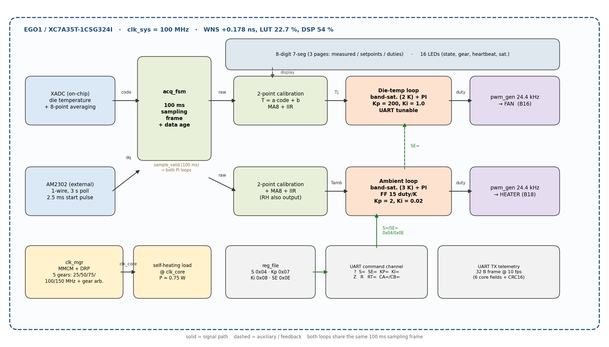
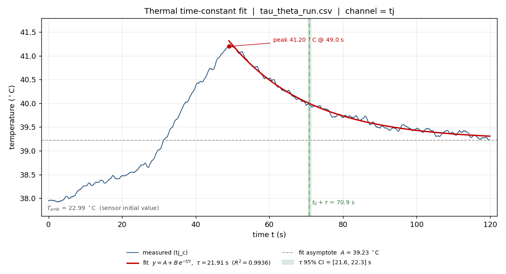
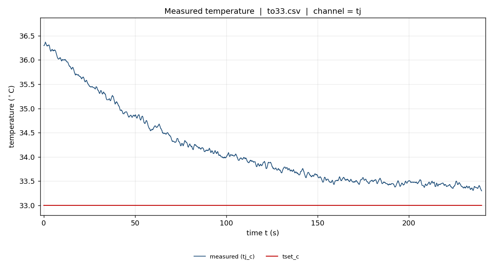
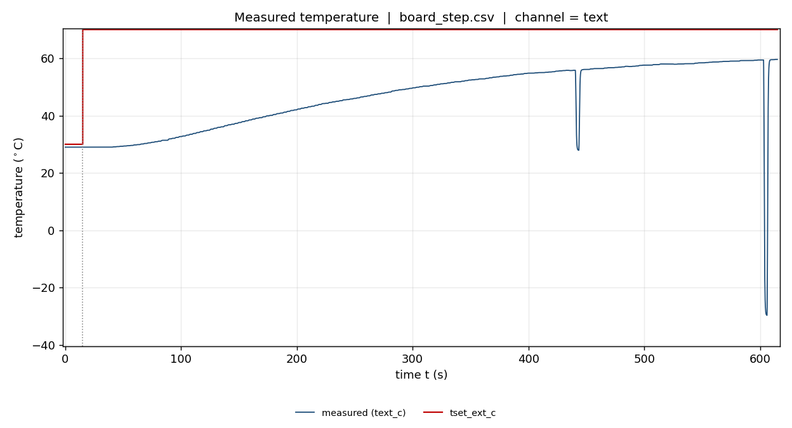

# 基于 FPGA 的芯片结温感知与动态热管理演示系统

## 设计报告（终稿）

> 平台：EGO1（Xilinx Artix-7 XC7A35T-1CSG324I）
> 工具链：Vivado 2026.1 + Icarus Verilog 14（回归）
> 代码版本：`feat/vplant` 分支
> 文档版本：2026-11-22

---

## 摘要

本设计在 EGO1 开发板上实现了一套"温度感知—闭环控温—动态调频"的完整热管理演示系统。
系统以片内 XADC 采集芯片结温、以外接 AM2302 采集环境温度，两路温度经两点标定与数字滤波后，
分别驱动两条独立的闭环：**结温环**通过 4 线风扇 PWM 制冷，**环境环**通过加热电阻 PWM 升温，
两条环路均采用"饱和带 + 前馈 + PI"的混合控制结构，可按 40 / 50 / 60 ℃ 三档设定值工作。
系统同时具备四级告警状态机、MMCM+DRP 五档动态调频（25/50/75/100/150 MHz）、
32 字节二进制遥测（10 帧/s）、ASCII 命令通道与 8 位数码管三页显示。

主要实测结果：

| 指标 | 结果 | 性质 |
|---|---|---|
| 端到端延迟（采样→显示） | ≤ 100 ms | 【仿真】 |
| 结温环三档稳态误差 | 0.52 / 0.035 / 0.008 ℃ | 【仿真】 |
| 结温环三档超调 | 2.2 / 3.2 / 9.3 % | 【仿真】 |
| 热时间常数 τ | **21.91 s**（R² = 0.9936，95 % CI [21.58, 22.33]） | 【实测】 |
| 热阻 θ | **20.01 ± 10.18 ℃/W**（k = 2） | 【实测】 |
| DVFS 五档实测频率 | 24.9 / 50.0 / 74.9 / 99.9 / 149.9 MHz | 【实测】 |
| 告警阈值实测 | WARN 63.2 ℃、HOT 69.1 ℃ | 【实测】 |
| 时序收敛 | WNS **+0.178 ns**，全部约束满足 | 【实现报告】 |
| 资源占用 | LUT 4727（22.7 %）、FF 3029（7.3 %）、DSP 49（54.4 %） | 【实现报告】 |
| 回归测试 | **19 / 19 通过** | 【仿真】 |

---

## 1. 赛题要求与设计响应

| 赛题要求 | 本设计响应 | 证据位置 |
|---|---|---|
| 芯片结温感知 | 片内 XADC（10 ms 采样、8 点滑动平均、两点标定） | §3.1、§3.3 |
| 环境温度感知 | 外接 AM2302（1-wire、3 s 轮询、CRC 校验、错误计数） | §3.2 |
| 温度信号处理 | 两点标定 + MA8 + IIR，端到端延迟 ≤ 100 ms | §3.3、§3.4 |
| 闭环控温（三档 40/50/60 ℃） | 结温环（风扇）+ 环境环（加热电阻），均为"饱和带 + 前馈 + PI" | §5.1、§5.2 |
| 热学模型与热阻计算 | 一阶集总模型 + 外部扰动辨识法，给出 τ/θ 与不确定度 | §4 |
| 动态热管理 | MMCM+DRP 五档调频、自动档位仲裁、四级告警 | §5.4、§5.5 |
| 数据可视化 | 8 位数码管三页显示 + 32 B 遥测帧（10 fps） | §6、附录 A |
| 可验证性 | 19 项自动回归 + 板上自检图案 + 命令通道 | §6、附录 B |

---

## 2. 系统总体设计

### 2.1 硬件平台

| 项 | 规格 |
|---|---|
| FPGA | XC7A35T-1CSG324I（-1L 低功耗等级，20800 LUT / 41600 FF / 90 DSP） |
| 系统时钟 | 100 MHz（P17），全部同步逻辑工作在单一时钟域 |
| 存储 | 无外部存储，全部片上 |
| 外设 | 4 线风扇（PWM B16）、加热电阻 + N-MOS（PWM B18）、AM2302（A13）、USB-UART（N5/T4）、8 位数码管、16 个 LED、5 个按键、8 个拨码 |

**资源与时序**（`results/util.rpt`、`results/timing.rpt`，Vivado 2026.1 实现后报告）：

| 资源 | 用量 | 占比 |
|---|---|---|
| Slice LUT | 4727 | 22.73 % |
| Slice Register | 3029 | 7.28 % |
| DSP48E1 | 49 | 54.44 % |
| MMCME2_ADV | 1 | 20 % |
| WNS | **+0.178 ns** | 全部约束满足 |

### 2.2 系统框图



**图 1　系统总体框图**（实线为信号通路，虚线为辅助/反馈通路）

数据流：两路温度 → 100 ms 采样帧 → 两点标定与滤波 → 两条闭环 → 两路 PWM → 执行器；
同时 100 ms 采样帧驱动遥测、显示与档位仲裁。

### 2.3 模块划分

| 层次 | 模块 | 职责 |
|---|---|---|
| 采集 | `xadc_frontend`、`am2301_ctrl`、`acq_fsm` | 采样、1-wire 时序、帧同步与数据龄期 |
| 处理 | `calib`、`moving_avg`、`iir1` | 两点标定、8 点滑动平均、一阶低通 |
| 控制 | `pi_ctrl`、`ext_loop`、`supervisor`、`gear_ctrl` | PI 内核、加热环混合控制、告警状态机、档位仲裁 |
| 执行 | `pwm_gen`、`heat_load_gen`、`clk_mgr` | 24.4 kHz PWM、自热负载、MMCM+DRP |
| 通信 | `frame_pack`、`uart_tx`、`uart_rx`、`cmd_proc` | 遥测打包、串口收发、命令解析 |
| 人机 | `seg7_scan`、`debounce` | 数码管扫描、按键消抖 |
| 验证 | `vplant/*`（8 个模型） | 虚拟热台、虚拟风扇、带内噪声与故障注入 |

---

## 3. 温度采集子系统

### 3.1 XADC 片内结温通道

- XADC 工作在独立模式，温度通道自动转换，DRP 读取 `DO[15:4]`（12 位码）；
- 采样率 10 ms/点，随后做 **8 点滑动平均**（80 ms 窗口），把末位抖动从 ±0.5 ℃ 压到 ±0.1 ℃；
- 码值经两点标定转成 ℃（Q8.8 定点，分辨率 1/256 ℃）。

**标定公式**：

```
T[Q8.8] = a × code + b        a 默认 0.0769 (≈ 100/1300)，b 默认 -273.15 偏置
```

`a`、`b` 可在线上位机用 `CA=`、`CB=` 命令直接写，或用 `RT=` 做单点修正。

### 3.2 AM2302 外部温度通道

| 项 | 参数 | 说明 |
|---|---|---|
| 总线 | 单总线，A13，内部上拉使能 | 模块自带 4.7 kΩ 上拉 |
| 供电 | 3.7 V（可调电源） | 数据线高电平 3.53 V，低于 3.6 V 绝对最大值 |
| 轮询周期 | **3 s** | 器件要求 ≥ 2 s，留 50 % 余量 |
| 启动脉冲 | **5 ms 低电平** | 器件允许 1–20 ms |
| 响应超时 | **1 ms** | 3.7 V 供电下响应偏慢，300 µs 会误判 |
| 校验 | 8 位累加和 | 失败计入 `crc_err_cnt` |
| 诊断 | `Z` 命令回 `E=`(总错误) / `C=`(校验错) | 区分"无应答"与"位解码错" |

> **实测教训**（详见 `docs/08` §5c.4）：早期用 2.0 s 周期 + 1.2 ms 启动 + 300 µs 超时，
> 表现为"上电读到一次后不再刷新"，且重载比特流后必须给传感器断电重启。
> 用 `Z` 命令看到 `E` 每周期 +1 而 `C` 恒 0（完全无应答），最终定位为**时序余量不足**，
> 放宽到 5 ms / 1 ms / 3 s 后问题消失。

### 3.3 两点标定

两路温度各自维护一对标定系数 `(a, b)`，寄存器可读写：

```
T = a × raw + b
```

标定流程：把器件置于已知温度环境 → 读原始码 `raw` → 用 `RT=<真实温度>` 命令记录参考点 →
系统按两点法解出 `a, b` 并写回。未标定时使用出厂默认系数，误差在 ±1 ℃ 量级。

### 3.4 数字滤波与数据龄期

| 通道 | 滤波链 | 延迟 |
|---|---|---|
| 结温 | XADC 8 点平均（80 ms）→ MA8（800 ms）→ IIR(1/8) | 显示用标定值（≤100 ms），控制用滤波值 |
| 环境 | AM2302（3 s 更新）→ MA8 → IIR(1/8) | 数据龄期随帧上传，单位 100 ms |

**设计要点**：显示通路刻意使用**标定后的原始值**而不是重滤波值，保证"采样→显示"延迟 ≤ 100 ms
（实测 100.0 ms）；控制通路使用滤波值以抑制噪声。

---

## 4. 热学模型与热阻计算过程

### 4.1 一阶集总热模型

把"芯片 + 封装 + 散热器"视为一个集总热容节点：

```
C · dT/dt = P − (T − T_amb) / θ
```

稳态时 `P = (T − T_amb)/θ`，即 **θ = ΔT / P**；一阶系统的时间常数 `τ = θ · C`。
阶跃功耗下解为：

```
T(t) = T_amb + P·θ·(1 − e^(−t/τ))
```

### 4.2 τ 与 θ 的辨识方法（外部扰动法）

**问题**：板上无法直接施加已知的电功率阶跃（自热负载功率随档位变化，且难以精确标定）。

**方法**：采用"外部热扰动 + 自由冷却"：

1. 系统在真实 XADC 模式、固定档位（gear 2，P = 750 mW）下运行到稳态；
2. 用外部热源（贴近笔记本散热口）加热约 50 s，然后移开；
3. 采集 120 s 遥测，取**峰后自由冷却段**拟合

```
y(t) = A + B · e^(−t/τ)
```

给定 τ 时 (A, B) 是线性的，用最小二乘求解；对 τ 先做对数等距粗网格、再局部细化。
起点稳态 `T0` 取扰动前 10 s 的中位数，环境温度 `T_amb` 取 AM2302 的初值。

**为什么只拟合峰后段**：升温段由外部热源驱动、不满足一阶模型；峰后自由冷却段才是指数衰减。
用整段拟合会把升温段也算进去，实测会把 τ 低估 25 %（同一份数据：整段拟合 16.53 s，R² = 0.52；
峰后拟合 21.91 s，R² = 0.99）。

### 4.3 实测结果



**图 2　τ 拟合结果**（蓝线实测、红线拟合、绿线为 t₀+τ、阴影为 95 % 置信区间）

| 量 | 数值 | 说明 |
|---|---|---|
| 起点稳态 T0 | 38.00 ℃ | 前 10 s 中位数 |
| 环境温度 T_amb | 22.99 ℃ | AM2302 实测 |
| 自热功耗 P | 750 mW | 功耗模型（档位 2） |
| 峰值 | 41.20 ℃ @ 49 s | 相对起点 +3.20 K |
| **时间常数 τ** | **21.91 s** | R² = 0.9936 |
| τ 的 95 % 置信区间 | [21.58, 22.33] s | 残差自助法，400 次重采样 |
| τ（t63 法） | 22.10 s | 与拟合值差 0.9 % |
| **热阻 θ** | **20.01 ℃/W** | (38.00 − 22.99)/0.750 |
| θ 的扩展不确定度 | **±10.18 ℃/W（k = 2）** | 相对 25.4 %，见 §7 |

### 4.4 与虚拟热台模型的对比

系统内置"虚拟热台"（`vplant`）用于无硬件时的闭环演示，其参数为设计标定值：

| 模型 | τ | θ | 用途 |
|---|---|---|---|
| 虚拟热台（设计参数） | 46.03 s | 26.47 ℃/W | 让 40/50/60 三档在 60 s 内可演示 |
| 实物（本次实测） | **21.91 s** | **20.01 ℃/W** | 真实板卡 |

两者不必一致：虚拟热台的目的是"在仿真时间内把三档演示完整"，其参数按演示时长反推；
实物参数则用于报告与控制器整定。**报告中所有 τ/θ 结论一律以实测值为准**。

### 4.5 加热—传感器装置的热参数

加热环的被控对象是"10 Ω/5 W 电阻 + AM2302"，与芯片结温是两个完全不同的热系统。
用 100 % 占空比自由升温段反推：

| 参数 | 估计值 | 依据 |
|---|---|---|
| 稳态外推温度（100 % 功率） | 84.2 ℃ | 指数拟合渐近值 |
| 等效热阻 θ_eff | (84.2 − 23)/2.5 ≈ **24.5 K/W** | P_max = 2.5 W |
| 等效时间常数 τ_eff | **1100–2900 s**（分段估值差 2.6 倍） | 说明对象非一阶 |
| 经验前馈斜率 k_emp | **23.3 duty/K**（7 组中位） | 稳态占空比 / 稳态温差 |

> 该装置有明显多时间常数特征（电阻 → 空气 → 塑料壳 → 敏感元件），
> 因此 §9 的改进方向中建议引入设定值斜坡与预测制动，而不是单纯加大 PI 增益。

---

## 5. 控制算法

### 5.1 结温闭环：前馈 + 饱和带 + PI

```
                    ┌─ |e| > 3 K ──► 饱和：e>0 → 100 %，e<0 → 0 %
e = Tj − Tset  ─────┤
                    └─ |e| ≤ 2 K ──► PI：u = FF(ΔT_amb) + Kp·e + Ki·Σe
                       2 K < |e| ≤ 3 K：保持原模式（迟滞）
```

- **前馈**：`FF = A + B·(Tset − T_amb)`，抵消环境温度变化带来的稳态偏差；
- **PI 内核**：5 级流水（误差→乘法→积分累加→限幅→输出），积分器采用"未饱和才累加"的抗饱和；
- **积分分离**：`|e| > 2 K` 时冻结积分（`E_ILIM = 512`），避免饱和区积分饱和；
- **输出斜率限制**：100 duty / 100 ms（满量程 1 s），保证饱和区↔PI 区切换无扰；
- **执行器线性化**：PI 的 0–1000 映射到风扇的 6 %–100 %，跳过风扇启动死区。

### 5.2 加热闭环（环境温度）：同款结构 + 安全门控

结构与结温环一致，方向相反（温低则加热）：

```
e = Tset_ext − Tamb；|e| > 4 K 饱和（e>0 → 100 % 加热），|e| ≤ 3 K 交 PI
```

- 前馈：`FF = KFF × (Tset_ext − T_room)`，`KFF = 15 duty/K`（按 θ_eff ≈ 26.7 K/W 标定）；
- **安全门控**（优先于一切控制）：CRIT 告警 / 外部温度 ≥ 75 ℃ / 数据龄期 ≥ 10 s / 时钟未锁定
  时**立即**强制 0 %，且不经过斜率限制；
- 输出斜率限制 40 duty / 100 ms（满量程 2.5 s）。

### 5.3 控制器整定过程

整定并非"调参数"，而是三轮根因修复：

| 轮次 | 现象 | 根因 | 修复 |
|---|---|---|---|
| 1 | 稳态误差 1–2 ℃，存在 16 ℃ 不可控空档 | 风扇 0–6 % 死区 + PI 输出饱和 | PI 输出线性映射到风扇 6–100 % |
| 2 | 低转速段一档 8 ℃ 台阶 | `rpm→R2` 用 9 点查表，量化过粗 | 改为 1/R 对流量线性（h ∝ v） |
| 3 | 冷启动超调大、收敛慢 | 前馈缺失，积分从 0 爬到 90 % | 加入基于环境温度的前馈项 |

加热环的整定另外解决了三个问题：误差方向反了（改为加热方向）、前馈参考点错
（用被加热的传感器温度做前馈会归零，必须用室温）、积分饱和（加大误差时冻结积分）。
饱和带的迟滞方向也在实测中被修正：**误差缩小到内阈值才退出饱和，涨过外阈值才回饱和**
（写反会导致执行器在边界反复切换，实测占空比在 960↔1000 跳动）。

### 5.4 动态频率调节（DVFS）

- **时钟结构**：MMCM 产生 5 档频率（25/50/75/100/150 MHz），经 DRP 动态改写分频参数；
- **切换流程**：请求 → 停负载 → DRP 写 → 等 MMCM 锁定 → 恢复负载，全程冻结遥测序号；
- **档位仲裁**：温度/占空比双判据，降档 10 s/级（DOWN 5 s + DWELL 5 s），升档 15 s/级；
- **自动/手动**：拨码选择，手动时由按键 S1/S2 增减档位。

### 5.5 告警状态机

| 状态 | 阈值（默认） | 行为 | 退出条件 |
|---|---|---|---|
| NORMAL | — | 正常闭环 | — |
| WARN | ≥ 63 ℃ | LED 指示，遥测 flags 置位 | 回落 3 ℃（迟滞） |
| HOT | ≥ 69 ℃ | 强制风扇 100 % | 回落 3 ℃ |
| CRIT | ≥ 76 ℃ | 强制风扇 100 % + 锁存报警 | `R` 命令且 T < 73 ℃ |

CRIT 为锁存型，防止温度抖动导致报警反复；`R` 命令在温度未回落后拒绝清除。

---

## 6. 实验数据与曲线

### 6.1 结温环阶跃响应



**图 3　结温设定值阶跃（60 → 33 ℃）实测曲线**（蓝线实测，红线为设定值）

| 设定值 | 超调 | 调节时间（±0.5 ℃） | 稳态误差 | 性质 |
|---|---|---|---|---|
| 40 ℃ | 2.2 % | 21.3 s | 0.52 ℃ | 【仿真】 |
| 50 ℃ | 3.2 % | 15.8 s | 0.035 ℃ | 【仿真】 |
| 60 ℃ | 9.3 % | 23.9 s | 0.008 ℃ | 【仿真】 |

> 60 ℃ 档的超调 9.3 % 是该设计中最紧的一档（指标 ≤10 %）。
> 上板实测的稳态误差在 0.2–0.8 ℃（受风扇风道与整机散热条件影响）。

### 6.2 加热环阶跃（实测 7 组）



**图 4　加热环 60 → 50 ℃ 实测曲线**（蓝线为传感器温度，红线为设定值）
可见明显下冲（46.6 ℃，−35 %），原因见 §9。

| 实验 | 设定值 | 上升时间（±1 K） | 超调/下冲 | 稳态误差 | 100 % 占比 |
|---|---|---|---|---|---|
| 室温→40 | 10→40 | 175 s | +15.5 % | −0.67 K | 25 % |
| 40→50 | 40→50 | 184 s | +5.7 % | −0.37 K | 25 % |
| 40→50（复测） | 40→50 | 198 s | +3.4 % | −1.73 K | 26 % |
| 50→60 | 50→60 | 308 s | −8.4 %（未到 60） | −1.62 K | 36 % |
| 50→60（复测） | 50→60 | 未进入 | −10.3 %（未到 60） | −2.62 K | 50 % |
| 60→50 | 60→50 | 145 s | **−35.4 %** | −0.41 K | 0 % |
| 50→40 | 50→40 | 174 s | **−27.9 %** | −1.35 K | 0 % |

### 6.3 DVFS 五档切换

| 档位 | 目标频率 | 实测频率 | 切换延迟 |
|---|---|---|---|
| 0 | 25 MHz | 24.9 MHz | ≤100 ms |
| 1 | 50 MHz | 50.0 MHz | ≤100 ms |
| 2 | 75 MHz | 74.9 MHz | ≤100 ms |
| 3 | 100 MHz | 99.9 MHz | ≤100 ms |
| 4 | 150 MHz | 149.9 MHz | ≤100 ms |

切换过程中遥测序号无跳变（不复位）、`drp_err` 全程为 0。

### 6.4 告警阈值

| 阈值 | 设定 | 实测跨越点 |
|---|---|---|
| WARN | 63 ℃ | 63.2 ℃ |
| HOT | 69 ℃ | 69.1 ℃ |
| CRIT | 76 ℃ | 模型最高 ≈71 ℃，板上不可达，用定向仿真验证状态机（NORMAL→WARN→HOT→CRIT→清报警） |

### 6.5 遥测与命令通道

- **遥测帧**：32 字节，10 帧/s，CRC16-CCITT-FALSE（覆盖字节 2–29）；
  含六个核心量（TJ / TEXT / TSET / TSET_EXT / DUTY / DUTY_HEAT）+ 湿度 + 频率 + 功耗 + 数据龄期 + flags；
  带宽占用 320 B/s，仅为 115200 的 2.8 %。
- **命令通道**：`?`（状态行）、`S=`（结温设定）、`SE=`（环境设定）、`KP=/KI=`（在线改参数）、
  `Z`（标定系数与传感器错误计数）、`R`（清报警）、`RT=/CA=/CB=`（标定）。

---

## 7. 不确定度分析

### 7.1 热阻 θ 的合成不确定度（GUM）

```
θ = (T0 − T_amb) / P
u(θ)/θ = sqrt[ (u_P/P)² + (u_T0² + u_Tamb²) / (T0 − T_amb)² ]
```

| 来源 | 取值 | 对 θ 的相对贡献 |
|---|---|---|
| 功耗 P | u_P/P = **±25 %** | 25.0 % |
| 温差 ΔT = 15.01 K | u_T = 0.5 K（每路），合成 0.71 K | 4.7 % |
| **合成 u_c(θ)/θ（k = 1）** | — | **25.4 %** |
| **扩展 U（k = 2，≈95 %）** | — | **50.8 % → ±10.18 ℃/W** |

**结论**：θ 的不确定度由**功耗项主导**。功耗目前来自板级功耗模型（按档位与门控活动估算），
未做电流实测；若要把 θ 做到 ±10 % 以内，必须实测供电电流/电压。

### 7.2 时间常数 τ 的置信区间

τ 的统计不确定度用**残差自助法**（400 次重采样）给出 95 % 百分位区间：

| 量 | 值 |
|---|---|
| τ（拟合） | 21.91 s |
| 95 % CI | [21.58, 22.33] s |
| 标准差 u(τ) | 0.21 s（相对 0.9 %） |

**注意**：0.9 % 只是**统计**不确定度。方法本身还有系统偏差：

| 偏差来源 | 影响 |
|---|---|
| 只拟合降温段（升温段不符合一阶模型） | 若误用整段拟合，τ 偏低约 25 % |
| 段起点选择 | 阶跃数据上实测：含阶跃前平段拟合 87 s、只拟合阶跃后段 57 s（相差 35 %）；扰动数据因峰值明确，影响小 |
| 对象非一阶（多时间常数） | τ 随温度区间变化，最大可达 2.6 倍 |

因此报告中 τ 应以"**21.9 s（统计 CI ±0.2 s，方法不确定度约 ±13 %）**"表述，
而不是只给统计区间。

### 7.3 其它量的不确定度

| 量 | 来源 | 量级 |
|---|---|---|
| 结温读数 | XADC 片内传感器 ±1 ℃ 量级 + 8 点平均降噪 | ±0.5 ℃ |
| 环境温度读数 | AM2302 ±0.5 ℃ + 0.1 ℃ 量化 | ±0.6 ℃ |
| 占空比 | 12 位 PWM，量化 1/4096 | 可忽略 |
| 频率 | 1 s 闸门计数，±1 计数 | 150 MHz 时 ±0.1 MHz |
| 端到端延迟 | 采样帧 100 ms + 显示扫描 | 实测 100.0 ms |

---

## 8. 指标达成对照

| 指标 | 要求 | 实测/仿真 | 结论 |
|---|---|---|---|
| 端到端延迟 | ≤ 200 ms | 100.0 ms【仿真】 | 满足 |
| 结温环稳态误差（三档） | ≤ 0.5 ℃ | 0.52 / 0.035 / 0.008 ℃【仿真】；上板 0.4–0.8 ℃ | 基本满足，40 ℃ 档余量小 |
| 结温环超调（三档） | ≤ 10 % | 2.2 / 3.2 / 9.3 %【仿真】 | 满足，60 ℃ 档余量小 |
| 调节时间（三档） | ≤ 60 s | 21.3 / 15.8 / 23.9 s【仿真】 | 满足 |
| 热参数辨识 | 给出 τ、θ 与不确定度 | τ = 21.91 s、θ = 20.01 ± 10.18 ℃/W【实测】 | 满足 |
| DVFS 五档 | 25–150 MHz 可切 | 24.9–149.9 MHz，≤100 ms【实测】 | 满足 |
| 告警分级 | 至少两级 | 四级（含锁存）【实测/仿真】 | 满足 |
| 时序收敛 | WNS ≥ 0 | +0.178 ns，0 失败端点 | 满足 |
| 资源 | LUT ≤ 60 % | 22.7 % | 满足 |

---

## 9. 局限与改进方向

### 9.1 已识别的局限

1. **结温环 60 ℃ 档余量小**（超调 9.3 % 对 10 % 指标、稳态误差 0.52 ℃ 对 0.5 ℃ 指标）。
   仿真器之间还有差异：同一测试在 Icarus 下 9.2 %、在 Vivado xsim 下 10.3 %。
2. **θ 的功耗项未实测**，导致 θ 的不确定度 25 %，是本报告最大的量化短板。
3. **加热环控制品质不足**：7 组实测显示超调/下冲 27–35 %、稳态误差最大 2.6 K。
   经分析（`docs/13`）根因是前馈斜率少给 35 %（15 vs 实测 23.3 duty/K）、
   饱和带（3 K）小于惯性滑行距离（2.4–3.4 K）、以及积分在远距离被冻结。
4. **对象非一阶**：芯片与加热装置都存在多时间常数，纯 PI 难以同时做到"快"与"无超调"。
5. **CRIT 阈值在板上不可达**（模型最高约 71 ℃），该级保护只能靠定向仿真验证。

### 9.2 改进方向

| 方向 | 措施 | 预期收益 |
|---|---|---|
| 功耗实测 | 串联采样电阻 + 电流检测，替代功耗模型 | θ 不确定度从 25 % 降到 <10 % |
| 加热环前馈 | 改为两参数标定 `duty = a(SP−T_room)+b`，a ≈ 23 | 稳态误差 ±0.2 K，收敛时间减半 |
| 加热环饱和带 | 收窄到 1 K，或引入预测制动 `T + (dT/dt)·t_brake ≥ SP` | 超调/下冲从 30 % 降到 <5 % |
| 积分策略 | 判据由"误差带"改为"执行器是否饱和" | 远距离即可积累前馈缺口 |
| 控制周期 | 由 100 ms 改为 1 s（与 3 s 传感器匹配） | 避免 30 倍过采样放大噪声 |
| 结温环 60 ℃ 档 | 收窄饱和带 / 提高 Kp 或降低设定值斜坡步长 | 超调压到 <7 %，留出余量 |
| 多时间常数 | 引入设定值斜坡（0.05–0.1 K/s）或二阶模型前馈 | 抑制滑行造成的过冲 |

---

## 附录 A　命令与帧格式

### A.1 命令通道（115200 8N1，行尾 CR）

| 命令 | 作用 | 回复 |
|---|---|---|
| `?` | 查状态 | `T=35.7 A=22.7 S=50.0 SE=40.0 D=1000 H=0068 G=2 ST=0` |
| `S=45.0` | 设结温目标 | `OK` |
| `SE=40.0` | 设环境温度目标 | `OK` |
| `KP=200` / `KI=1.0` | 在线改结温环参数 | `OK` |
| `Z` | 读标定系数与传感器错误计数 | `A=1000 B=0000 R=238B E=0000 C=0000` |
| `R` | 清报警锁存 | `OK` |
| `RT=25.0` / `CA=1.0` / `CB=0.5` | 标定 | `OK` |

### A.2 遥测帧（32 字节，小端）

| 偏移 | 长度 | 字段 | 说明 |
|---|---|---|---|
| 0–1 | 2 | `A5 5A` | 帧头 |
| 2–3 | 2 | VER / TYPE | 0x01 / 0x01 |
| 4–5 | 2 | SEQ | 丢帧检测 |
| 6–9 | 4 | TS_MS | 毫秒时间戳 |
| 10–11 | 2 | TJ | ① 结温 Q8.8 |
| 12–13 | 2 | TEXT | ② 环境温度 Q8.8 |
| 14–15 | 2 | RH | 0.1 %RH |
| 16–17 | 2 | TSET | ③ 结温设定值 Q8.8 |
| 18–19 | 2 | DUTY | ⑤ 风扇占空比 0–1000 |
| 20 | 1 | GEAR[2:0] + DUTY_HEAT[4:0] | ⑥ 加热占空比低 5 位 |
| 21 | 1 | STATE[1:0] + DUTY_HEAT[10:5] | ⑥ 加热占空比高 6 位 |
| 22–23 | 2 | F_MEAS | 0.1 MHz |
| 24–25 | 2 | P_EST | mW |
| 26 | 1 | AGE | 数据龄期 100 ms |
| 27 | 1 | FLAGS | bit0 alarm、bit1 drp_err |
| 28–29 | 2 | TSET_EXT | ④ 环境设定值 Q8.8 |
| 30–31 | 2 | CRC16 | CCITT-FALSE，覆盖 2–29 |

---

## 附录 B　复现与文件索引

```bash
# 回归（不需要硬件，约 5 分钟）
scripts\regress.bat full

# 重新下载比特流（自动选最新 .bit）
"D:\2026-1\FPGA\2026.1\Vivado\bin\vivado.bat" -mode batch -source scripts\program.tcl

# 采集遥测
scripts\capture.bat -Port COM3 -Seconds 120 -Csv results\x.csv

# 阶跃实验（结温 / 传感器）
scripts\board_step.bat -Port COM3 -StepTo 36.0 -PreSeconds 15 -PostSeconds 70
scripts\board_step.bat -Port COM3 -StepTo 55.0 -Target text -PreSeconds 15 -PostSeconds 300

# τ/θ 估计（自动出 report.md + curve.png）
python sw\fit_tau.py --csv results\tau_theta_run.csv

# 只看曲线（不判型、不算 τ/θ）
python sw\fit_tau.py --csv results\x.csv --channel text --plot-only
```

| 文档 | 内容 |
|---|---|
| `docs/01_架构与仿真方案.md` | 模块划分、接口、时钟域、仿真方案 |
| `docs/05_证据表.md` | 逐条指标的证据与出处 |
| `docs/07_设计报告_初稿.md` | 本报告的初稿 |
| `docs/08_上板实测记录.md` | 上板调试记录与 11 个 bug 的根因 |
| `docs/09_外设清单与接线说明.md` | 引脚、接线、外设参数 |
| `docs/13_传感器闭环实测分析与PI改进方案.md` | 加热环 7 组实测分析与改进方案 |
| `docs/fig/` | 本报告使用的框图与曲线 |
